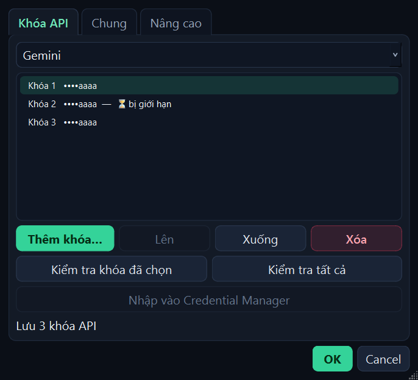

<p align="center">
  
</p>

<h1 align="center">DubTool</h1>

<p align="center">
  <strong>One-click multilingual-to-Vietnamese video dubbing for Windows — local ASR, offline VieNeu-TTS v3 voices, and burned Vietnamese subtitles.</strong>
</p>

<p align="center">
  <a href="https://github.com/namtit2932k/dubtool/releases/latest"></a>
  <a href="LICENSE"></a>
  
</p>

<p align="center">
  <strong>English</strong> · <a href="docs/README.vi.md">Tiếng Việt</a>
</p>

<p align="center">
  <a href="https://github.com/namtit2932k/dubtool/releases/latest"></a>
</p>

---

DubTool automatically detects the spoken language of any video (or uses your manual pick), transcribes speech **100% locally** with `faster-whisper`, translates to natural Vietnamese using your chosen LLM (**Gemini**, **OpenAI**, **Anthropic**, or local **Ollama**), synthesizes natural Vietnamese speech **100% offline** with **VieNeu-TTS v3 ONNX** (`48 kHz` Turbo INT8 or low-RAM `24 kHz` Nano), fits the timing cleanly to the original audio, mixes over the lowered original track with an anti-clipping limiter, burns Vietnamese subtitles, and exports a readable `.docx`/`.txt` translation alongside the final video.

If the input video is already in Vietnamese, DubTool stops before translation and lets you export `.srt` subtitles and a clean transcript with zero API calls.

> ⚖️ Only dub videos you own or have permission to modify. By using DubTool you agree to the [MIT License](LICENSE) and bundled [third-party notices](packaging/THIRD_PARTY.md).

<p align="center">
  
</p>

---

## Highlights

- **Local & Private Core:** Video, audio, speech recognition (`faster-whisper`), and Vietnamese voice synthesis (`VieNeu-TTS v3 ONNX`) all run locally on your PC. Only recognized transcript text is sent to your chosen translation LLM.
- **25+ Offline Vietnamese Voices:** Ships with `v3turbo_int8` (48 kHz, natural studio quality, default voice *Trúc Ly*) and `v3nano` (24 kHz, low RAM ~480 MB). Models download once (~244–269 MB) and work offline forever.
- **Timing-Aware Dubbing:** Repairs Whisper word-timestamp drifts and internal pauses, fits speech smoothly with `atempo` / LLM shortening, prevents overlapping Vietnamese clips, and matches burned subtitles to actual playback times.
- **Never Overwrites Input:** Original videos stay untouched. Every stage is idempotent and resumable — cancel anytime and resume without losing finished clips.
- **Secure Key Storage:** API keys live in **Windows Credential Manager** (or `.env` for CLI) and are never written to `settings.json`, logs, or job folders.

---

## Pipeline (7 Resumable Stages)

| Stage | What it does |
| --- | --- |
| **s1** Extract audio | Extracts mono 16 kHz WAV from the input video via bundled FFmpeg |
| **s2** Transcribe | Local `faster-whisper` with VAD + word-timestamp repair → `transcript.json` |
| **s3** Translate | Sentence-level translation with context, glossary, brief, pronoun rules, and budget enforcement |
| **s4** Text-to-Speech | Offline VieNeu-TTS v3 ONNX (`v3turbo_int8` / `v3nano`) with silence trimming & WAV clip cache |
| **s5** Fit duration | Fits each clip to its slot via `atempo` stretch or LLM shortening + re-TTS |
| **s6** Mix & mux | Lowers original audio (default `−14 dB`), schedules non-overlapping dub clips, applies `alimiter` |
| **s7** Subtitles & export | Generates `.srt`, burns Vietnamese-safe subtitles (`libass`), and exports `.docx`/`.txt` transcript |

---

## Screenshots




---

## Quick Start

### Option 1: Portable Windows App (Recommended)

1. Download the latest `DubTool-*-win64.zip` from [GitHub Releases](https://github.com/namtit2932k/dubtool/releases/latest) and extract it anywhere.
2. Run **`DubTool.exe`** (FFmpeg and Vietnamese fonts are bundled — no Python install needed).
3. Open **Settings → API keys** and add a free [Google AI Studio](https://aistudio.google.com/apikey) Gemini key (or OpenAI / Anthropic key).
4. Drop a video, choose an output folder, and click **Tạo** (Generate).
   - *First run only:* Whisper and VieNeu-TTS ONNX models (~244–269 MB) download automatically into `%LOCALAPPDATA%\DubTool\models\hf_cache`.

### Option 2: Run from Source / CLI

Requires **Python 3.11+** (3.13 recommended) and **FFmpeg on `PATH`**.

```bash
pip install -e .[dev]
copy .env.example .env      # add GEMINI_API_KEY=...
dubtool doctor              # verify FFmpeg, keys, and dependencies
```

**Desktop GUI from source:**

```bash
python -m dubtool.app.main
```

**CLI usage:**

```bash
dubtool run video.mp4 --source-language auto --model gemini-3.5-flash-lite --tts-mode v3turbo_int8 --voice "Trúc Ly"
dubtool stage <job_id> <s1..s7> [--force]
dubtool status <job_id>
dubtool retts <job_id> --ids 3,7,12
```

- Pass `--brief "text"` or place `<video>.brief.txt` next to the video to guide tone/terminology.
- Copy `glossary.example.json` → `glossary.json` for fixed domain terms.
- See [README_BUILD.md](README_BUILD.md) for packaging `DubTool.exe` from source.

---

## Configuration & Providers

| Provider | Config / Key | Notes |
| --- | --- | --- |
| **Gemini** (default) | `GEMINI_API_KEY` | Free tier available; default model `gemini-3.5-flash-lite` |
| **OpenAI** | `OPENAI_API_KEY` | Paid API |
| **Anthropic** | `ANTHROPIC_API_KEY` | Paid API |
| **Ollama** | `llm_provider: ollama` | 100% local & private; quality depends on local model |

> **Note on Gemini Free Tier:** Quotas are enforced per Google Cloud project and per model. Extra keys from separate projects rotate automatically on `429`.

Default pipeline tunables (`whisper_model`, `chars_per_sec`, `max_stretch`, `mix`, `subtitles`, `tts`) live in [`config.yaml`](config.yaml) and can be overridden via CLI flags or the desktop Settings dialog.

---

## Development & Tests

```bash
python -m pytest tests -q                 # 590+ offline tests (no API key or network needed)
python -m dubtool.app.main --selftest     # runtime/FFmpeg/Qt/VieNeu self-check
python -m dubtool.app.main --layout-check # UI geometry & overflow invariants
python -m dubtool.app.main --gui-smoke    # isolated real-widget end-to-end smoke test
```

---

## Privacy & License

- **Privacy:** Speech recognition (`faster-whisper`) and Vietnamese TTS (`VieNeu-TTS v3 ONNX`) run locally on your machine. Only source-language transcript text is sent to the translation LLM you configure. API keys are stored in Windows Credential Manager / `.env` and never logged.
- **License:** [MIT License](LICENSE) — Copyright (c) 2026 sickyturtlez. Bundled third-party components (FFmpeg, PySide6, faster-whisper, VieNeu-TTS, sea-g2p, soundfile) retain their respective licenses; see [`packaging/THIRD_PARTY.md`](packaging/THIRD_PARTY.md).
