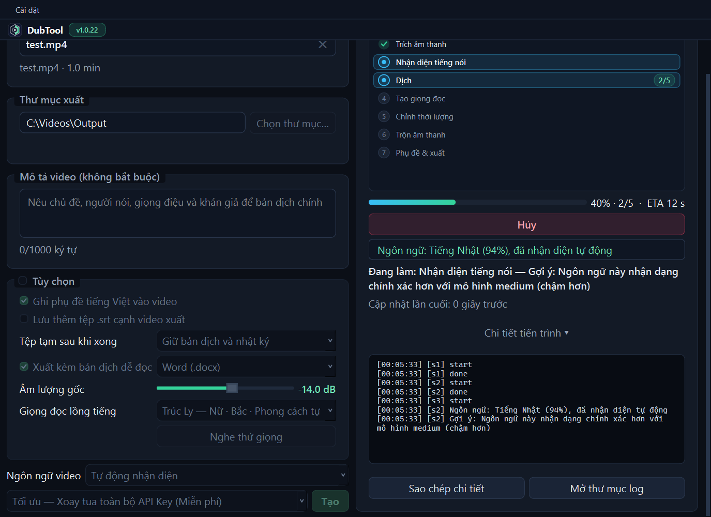
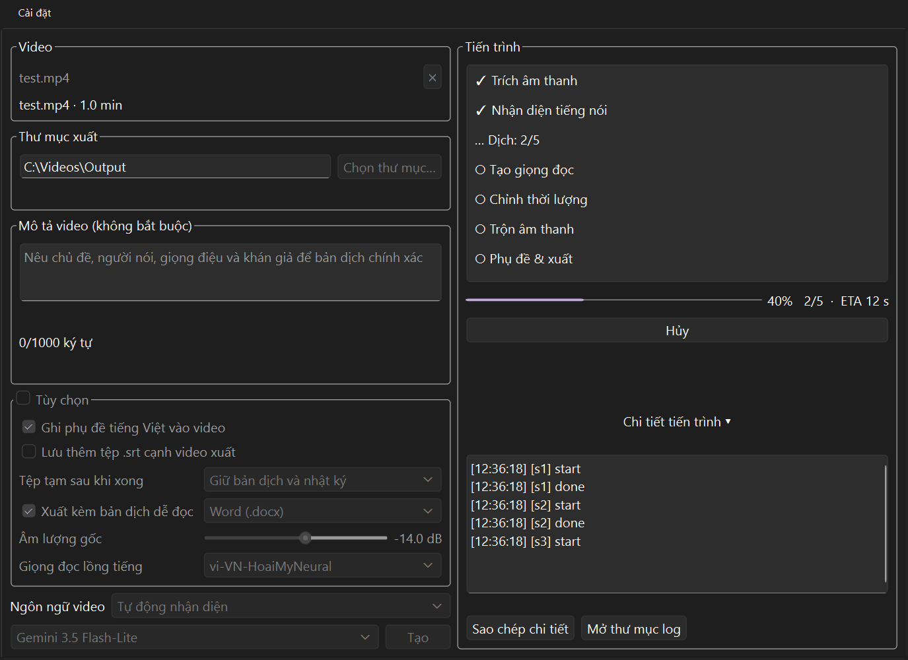
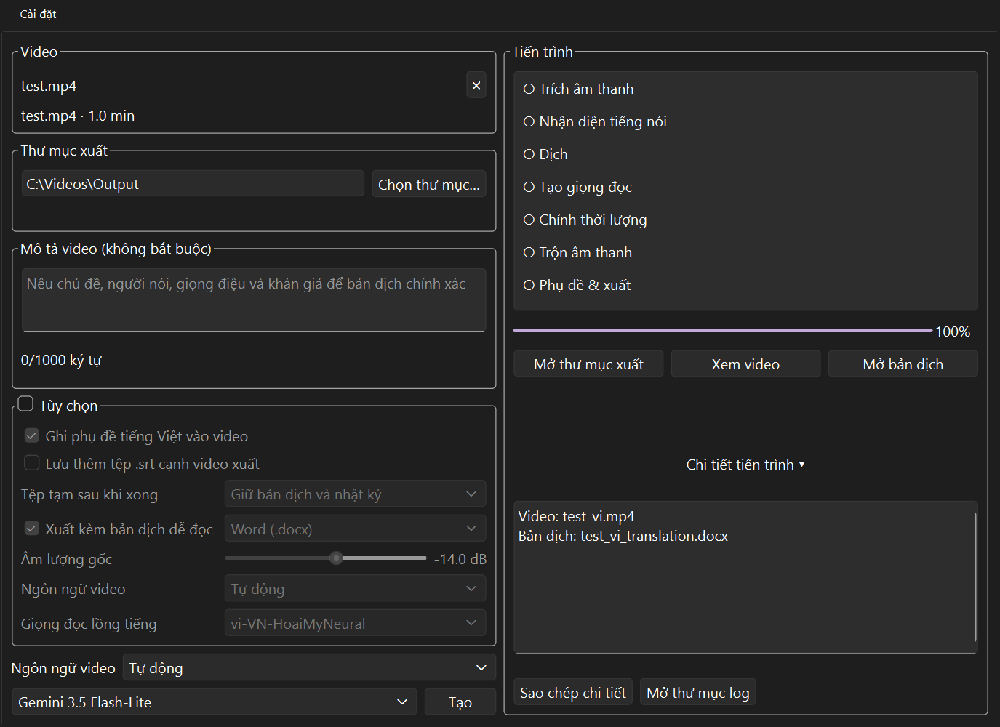

# DubTool — Multilingual → Vietnamese video dubbing

DubTool detects the spoken source language of a video automatically (or uses a
manual language choice), transcribes it locally with `faster-whisper`, translates
it to Vietnamese with a configurable LLM (Gemini, OpenAI, Anthropic, or Ollama),
generates a Vietnamese voice track, fits the speech into the original timing,
mixes it over the lowered original audio, burns Vietnamese subtitles, and exports
a customer-readable translation file (`.docx`/`.txt`).

If the input video is already in Vietnamese, DubTool stops before translation
and offers to export `.srt` subtitles and a readable transcript without calling
any translation or voice service.

> Only dub videos you own or have permission to modify.


## How it works

Seven resumable stages, all driven by the same code from the CLI and the app:

| Stage | What it does |
| --- | --- |
| s1 extract audio | mono 16 kHz WAV from the input video (FFmpeg) |
| s2 transcribe | faster-whisper (local, no upload) → `transcript.json`, then cleanup: merges too-short segments, splits too-long ones, dedupes boundary repeats |
| s3 translate | Gemini (pluggable) sentence-level units with context, glossary, optional video brief, pronoun consistency, then an enforcement pass on segments over the character budget |
| s4 text-to-speech | offline VieNeu-TTS v3 ONNX (`v3turbo_int8` 48 kHz default, `v3nano` 24 kHz low-RAM) with silence trimming and a content-addressed WAV clip cache |
| s5 fit duration | stretch (atempo), LLM shortening with re-TTS, or overflow — never silently rewrites a reviewed translation |
| s6 mix and mux | lowers the original audio (default −14 dB), places clips on the schedule, never lets Vietnamese clips overlap, closes with `alimiter` |
| s7 burn subtitles | SRT + libass burn, Vietnamese-safe font sizing, temp file + atomic replace |

Every JSON write is atomic; every stage is idempotent — rerun anything with
`--force`, resume everything else for free.

## Setup

Requires **Python 3.11+** and **FFmpeg on `PATH`**.

```bash
pip install -e .[dev]
copy .env.example .env      # then put your GEMINI_API_KEY in .env
```

Get a free key at [Google AI Studio](https://aistudio.google.com/apikey) — no
card needed. Optional extra keys `GEMINI_API_KEY_2`, `GEMINI_API_KEY_3` spread
one key's free-tier daily quota; the pipeline rotates automatically on 429.

> **Gemini free-tier quotas are per project and per model**, not per key.
> Several API keys created inside the same Google project share one quota, so
> rotating between them does **not** add capacity — only keys from different
> projects do. Check Google's terms of service before creating extra projects
> or accounts for quota purposes.

Check your environment (FFmpeg, key, deps):

```bash
dubtool doctor
```

## Command-line usage

```bash
dubtool run sample.mp4 [--source-language auto|en|ja|...] [--subtitles-only] [--model gemini-3.5-flash-lite] [--tts-mode v3turbo_int8|v3nano] [--voice "Trúc Ly"] [--whisper-model small] [--force]
dubtool stage <job_id> <s1..s7> [--source-language auto|<code>] [--force]
dubtool status <job_id>
dubtool retts <job_id> --ids 3,7,12
dubtool compare-translate <job_id> --models gemini:gemini-3.5-flash-lite,gemini:gemini-3.8-flash
dubtool review-zip
```

- `run` copies the video into `jobs/<job_id>/`, runs all stages, and writes the
  final MP4 plus `output.vi.srt` and useful intermediates
  (`transcript.json`, `translated.json`, `tts/`, `fitted/`, `schedule.json`).
- `stage` re-runs a single stage; the job directory is the resume unit.
- A video description helps the translator: pass `--brief "text"` or keep a
  `<video>.brief.txt` next to the video (topic, speaker, tone, audience).
- Optional terminology: copy `glossary.example.json` → `glossary.json`.

### Translation providers

| Provider | Config | Notes |
| --- | --- | --- |
| **Gemini** (default) | `llm_provider: gemini` | free tier; may use submitted content to improve products |
| Ollama | `llm_provider: ollama` | local + private; Vietnamese quality varies by model |
| Anthropic | `llm_provider: anthropic` | paid; `ANTHROPIC_API_KEY` in `.env` |

Model IDs live in `config.yaml` (and, for the app, in `packaging/modes.yaml`):
**Fast** = `gemini-3.5-flash-lite`, **Accurate** = `gemini-3.8-flash`.
Translate chunks run independently and can be parallelized with
`translate.concurrency` (accurate mode: 3).

## Desktop app (Windows, in development)

```bash
pip install PySide6 keyring
python -m dubtool.app.main            # GUI (Vietnamese by default, English in Settings)
python -m dubtool.app.main --selftest # offline checks: FFmpeg/libass/libx264/font/keyring/Qt
python -m dubtool.app.main --screenshots shots/  # render UI states as PNGs
python -m dubtool.app.main --headless-run video.mp4 outdir/ --mode fast
```

- Drop a video, pick an output folder, press **Tạo nhanh** (fast) or
  **Tạo chính xác** (accurate) — or follow the staged progress with cancel,
  resume, and start-over. While a run is in progress the options and
  Settings are locked read-only; the **Chi tiết tiến trình** (progress
  details) panel shows what is happening right now, with a live log.
- A video that was chosen shows as a compact **file card** with an **X** to
  deselect. When the run finishes, the panel offers Open folder, Play, and
  Open translation.
- The Gemini key is stored in **Windows Credential Manager** (keyring), never
  in `settings.json`, logs, or the job folder.
- Audio, video, speech recognition (`faster-whisper`), and Vietnamese voice
  synthesis (**VieNeu-TTS v3 ONNX**) all run **100% locally** on your machine.
  Only the recognized source-language transcript text is sent to your chosen
  LLM provider for translation. An internet connection is needed on the first
  run to download local Whisper and VieNeu-TTS models (~244–269 MB) from
  Hugging Face.









## Configuration

`config.yaml` holds the tunables you are most likely to touch:
`whisper_model`, `chars_per_sec` (speech-rate budget, re-measured on trimmed
clips), `max_stretch`, `mix` (mode, original gain, limiter), `subtitles`
(size, margin, font), `translate.concurrency` and `translate.pronouns`.
Everything is also overridable per command line; run `dubtool run --help`.

## Development

```bash
py -m pytest            # 185 offline tests; providers mocked, no key needed
py -m dubtool doctor    # environment sanity check
```

Key internals:

- `src/dubtool/api.py` — `run_dub()`: the library entry the app and CLI share
  (mode resolution, stable job id, cancel between segments/stages, atomic
  output delivery, no silent overwrite).
- `src/dubtool/app/` — desktop app package: settings, secrets (keyring),
  modes (fast/accurate), i18n (vi/en), worker service, error mapping,
  diagnostics export, selftest.
- `agent/` — development session notes and specs (AGENT.md …), kept for
  history; the pipeline itself does not read them.

## Privacy

- Speech recognition runs locally (faster-whisper); audio/video stays on disk.
- Transcript text is sent to the configured LLM provider for translation.
- On free tiers, providers may use submitted content to improve their products.
- The API key lives in `.env` (CLI) or Windows Credential Manager (app) and is
  never printed, logged, or written into job artifacts.

## License

MIT License. Copyright (c) 2026 sickyturtlez.
Bundled third-party runtime components — FFmpeg (GPL build compliance note in
`packaging/THIRD_PARTY.md`), faster-whisper, VieNeu-TTS / sea-g2p / soundfile, Qt — keep
their own licenses and are **not** committed to this repository.
