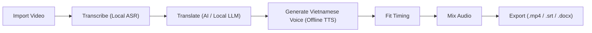

<p align="center">
  
</p>

<h1 align="center">DubTool</h1>

<p align="center">
  <strong>Portable Windows desktop app for multilingual-to-Vietnamese video dubbing — local speech recognition, multi-key Auto-Rotate AI translation, offline Vietnamese TTS, and synchronized subtitles.</strong>
</p>

<p align="center">
  <a href="https://github.com/namtit2932k/dubtool/releases/latest"></a>
  <a href="https://github.com/namtit2932k/dubtool/actions/workflows/ci.yml"></a>
  <a href="LICENSE"></a>
  
</p>

<p align="center">
  <strong>English</strong> · <a href="docs/README.vi.md">Tiếng Việt</a>
</p>

<p align="center">
  <a href="https://github.com/namtit2932k/dubtool/releases/latest"></a>
</p>

---

## Overview

**DubTool** turns foreign-language videos into Vietnamese-dubbed videos with synchronized subtitles. It combines local speech recognition, context-aware AI translation, offline Vietnamese speech synthesis, automatic audio timing, and a resumable media-processing pipeline in a portable Windows desktop app (Python + PySide6, packaged as a standalone `.exe` with a full CLI).

- **Input:** Any foreign-language video (short clips to multi-hour lectures, tutorials, or dramas). Your original input file is **never** modified or overwritten.
- **Output:**
  - A dubbed Vietnamese **`.mp4`** video with original audio ducked underneath.
  - Synchronized Vietnamese **`.srt`** subtitles and/or burned-in subtitles (configurable).
  - A side-by-side readable **`.docx` / `.txt`** translation document.
- **Vietnamese-source guard:** If the input video is already in Vietnamese, DubTool stops before translation and offers to export `.srt` subtitles and a clean transcript with no translation API calls.

> ⚖️ Only dub videos you own or have permission to modify. By using DubTool you agree to the [MIT License](LICENSE) and bundled [third-party notices](packaging/THIRD_PARTY.md).

---

## Screenshots

| Main Window (Ready) | Language Auto-Detect & Picker |
| :---: | :---: |
|  |  |

| Live Progress & Language Confidence | Running Activity & Cancel Control |
| :---: | :---: |
|  |  |

| Finished Output Actions | Secure API Key Manager |
| :---: | :---: |
|  |  |

---

## How It Works



1. **Import Video** — Auto-detects spoken language or uses your manual language choice.
2. **Transcribe & Translate** — Transcribes speech locally, then translates complete sentences into natural spoken Vietnamese using context, optional brief, and glossary.
3. **Synthesize, Fit & Mix** — Generates Vietnamese voice clips offline, aligns each clip to its real speech window, ducks the original soundtrack with a limiter, and exports your video, subtitles, and readable transcript.

---

## Why DubTool

### Smart Translation & Free-Tier Auto-Rotate
- **Default `auto-rotate` mode:** Rotates across all saved free **Gemini** and **Groq** API keys across parallel workers. When a model or key hits transient overload (`503`) or rate limits (`429`), DubTool places that slot on cooldown and switches to another ready key or provider immediately without waiting out the cooldown.
- **Strict free/paid separation:** Paid **OpenAI** and **Anthropic** keys are **never** used automatically in Auto-Rotate mode; selecting a paid model explicitly prompts for confirmation before the first paid run.
- **Context & quality guards:** Supports an optional **Video Brief** (to guide tone, genre, and Vietnamese pronouns), custom **Glossary** terms, pronoun consistency across chunks, and automatic detection/retry if untranslated CJK characters leak into the Vietnamese output.

### Local & Offline Speech Processing
- **Local ASR (`faster-whisper`):** Runs entirely on your PC with voice activity detection (VAD), word-timestamp and internal-silence repair, and mid-stage cancellation.
- **Offline Vietnamese TTS (`VieNeu-TTS v3 ONNX`):** Runs on CPU in either standard `v3turbo_int8` (48 kHz, 25 voices, default *Trúc Ly*) or low-RAM `v3nano` (24 kHz, 11 voices) mode, with a built-in **Voice Preview** button. Models download once (~244–269 MB) and work offline afterward.

### Built for Long-Form Video
- **Resumable checkpoints:** Both pipeline stages (`s1`–`s7`) and translation chunks are checkpointed on disk — cancel at any point and resume without redoing completed work.
- **Smart stage reuse:** Changing the translation model automatically reuses existing `s1`/`s2` audio extraction and transcription outputs.
- **Streaming audio mixer:** Renders the Vietnamese dub track in 30-second blocks with `soundfile` + `numpy`, keeping memory usage bounded, avoiding multi-gigabyte intermediate silence WAV files, and enabling RF64 automatically for large tracks (>3.8 GB).

### Precise Audio & Subtitle Output
- **Per-sentence duration fitting:** Aligns each dubbed clip to its real timeline slot using gentle `atempo` adjustment or targeted LLM shortening + re-synthesis so neighboring sentences do not overlap.
- **Balanced mix & synced subtitles:** Lowers the original soundtrack (`−14 dB` default) with an `alimiter` anti-clipping stage, generates `.srt` timing matched to actual dubbed playback, optionally burns Vietnamese subtitles via `libass` + bundled Noto Sans, and exports a readable `.docx` / `.txt` translation.

### Privacy & Safe Key Handling
- **Clear local vs. cloud boundary:** Speech recognition, Vietnamese TTS (after the initial model download), audio mixing, and subtitle rendering run locally on your machine. Cloud translation requires Internet access and sends only the recognized source transcript plus optional user-provided context (Brief / Glossary) to the provider you chose. **Ollama** is available for fully local translation.
- **Encrypted key storage:** Desktop API keys are stored in **Windows Credential Manager** (or `.env` for CLI), masked in the UI, redacted from logs and diagnostics, and never written to `settings.json` or job folders.

---

## Pipeline Architecture

DubTool runs **7 resumable stages** (`s1`–`s7`), followed by a post-pipeline readable document export (`s8_export_readable.py`):

| Stage | Responsibility |
| --- | --- |
| **s1** Extract audio | Extracts mono 16 kHz WAV from the input video via bundled FFmpeg |
| **s2** Transcribe | Local `faster-whisper` ASR with auto language detection, VAD, timestamp repair, and cancel support |
| **s3** Translate | Chunked sentence translation with context, brief, glossary, pronoun consistency, and CJK-leak checks |
| **s4** Text-to-Speech | Offline `VieNeu-TTS v3 ONNX` synthesis with silence trimming and per-unit WAV cache |
| **s5** Fit duration | Fits clips cleanly into their slots via gentle `atempo` or LLM shortening + re-TTS |
| **s6** Mix & mux | 30s-block streaming dub-track mix (`soundfile` + `numpy`, RF64-safe) over ducked original audio + `alimiter` |
| **s7** Subtitles & mux | Generates synced `.srt` and optionally burns Vietnamese subtitles (`libass` + bundled Noto Sans) |
| *Post-pipeline* Export | Writes the side-by-side readable `.docx` / `.txt` translation next to the output video |

See [`docs/ARCHITECTURE.md`](docs/ARCHITECTURE.md) for module boundaries, resume hashing, and LLM resilience details.

---

## Quick Start

### Option 1: Portable Windows App (Recommended)

1. Download the latest `DubTool-*-win64.zip` from [GitHub Releases](https://github.com/namtit2932k/dubtool/releases/latest) and extract it to any folder.
2. Launch **`DubTool.exe`** (FFmpeg and Noto Sans Vietnamese font are bundled — no Python installation required).
3. Open **Settings → API keys** and add one or more free API keys:
   - [Google AI Studio](https://aistudio.google.com/apikey) (**Gemini** free tier), and/or
   - [Groq Console](https://console.groq.com/keys) (**Groq** free tier — pairs with Gemini in the default **Auto-Rotate** mode).
   - *(Optional)* Add **OpenAI** or **Anthropic** paid keys, or configure local **Ollama**.
4. Drag & drop a video, optionally enter a short **Brief** (e.g., genre and preferred Vietnamese pronouns), choose an output folder, and click **Tạo** (Generate).
   - *First run only:* Whisper ASR and VieNeu-TTS ONNX models (~244–269 MB) download automatically to `%LOCALAPPDATA%\DubTool\models\hf_cache`; subsequent runs of ASR/TTS work offline.

### Option 2: Run from Source / CLI

Requires **Python 3.11+** (**3.13 x64** recommended) and **FFmpeg on `PATH`**.

```bash
pip install -e ".[gui,dev]"             # CLI + Desktop GUI (PySide6-Essentials, keyring) + pytest
pip install --no-deps "vieneu>=3.8,<4"  # VieNeu-TTS v3 ONNX (avoids pulling optional WebUI/gradio extras)
copy .env.example .env                  # add GEMINI_API_KEY=... and/or GROQ_API_KEY=...
dubtool doctor                          # verify FFmpeg, keys, and dependencies
```

**Launch the Desktop GUI:**

```bash
python -m dubtool.app.main
```

**Run from the CLI:**

```bash
dubtool run video.mp4 --source-language auto --model auto-rotate --tts-mode v3turbo_int8 --voice "Trúc Ly"
dubtool stage <job_id> <s1..s7> [--force]
dubtool status <job_id>
dubtool retts <job_id> --ids 3,7,12
```

- Pass `--brief "text"` or place `<video>.brief.txt` beside the input video to guide tone and pronouns.
- Copy `glossary.example.json` → `glossary.json` for domain terms (use `"keep original"` to leave a term untranslated).
- See [`README_BUILD.md`](README_BUILD.md) for packaging `DubTool.exe` from source.

---

## Translation Providers

| Provider | Tier / Mode | Configuration | Role |
| --- | --- | --- | --- |
| **Auto-Rotate** *(default)* | Free tier | Saved Gemini + Groq keys | Interleaves all saved free Gemini and Groq keys with overload/rate-limit rotation; never uses paid keys |
| **Gemini** | Free tier | `GEMINI_API_KEY` | Structured JSON translation across supported Gemini models |
| **Groq Cloud** | Free tier | `GROQ_API_KEY` | Fast inference with compact prompts and multi-key rotation |
| **OpenAI** | Paid API | `OPENAI_API_KEY` | Optional paid models; prompts once before the first paid run |
| **Anthropic** | Paid API | `ANTHROPIC_API_KEY` | Optional paid Claude models; prompts once before the first paid run |
| **Ollama** | Local | `llm_provider: ollama` | Fully local translation with no cloud requests |

The full supported model list lives in [`packaging/models.yaml`](packaging/models.yaml), and default pipeline settings live in [`config.yaml`](config.yaml).

> **Tip for long videos:** Adding multiple free Gemini keys (from separate Google Cloud projects) together with free Groq keys in **Auto-Rotate** mode helps keep multi-hour jobs moving smoothly during free-tier rate-limit bursts.

---

## Engineering & Reliability

DubTool is maintained as a tested Windows desktop application with automated verification in GitHub Actions (`.github/workflows/ci.yml`):

- **Multi-version Windows CI:** Runs on **Windows Python 3.11** (compatibility check against `pyproject.toml` ranges) and **Windows Python 3.13** (pinned lockfile environment via [`packaging/requirements-lock.txt`](packaging/requirements-lock.txt)).
- **600+ automated offline tests:** Full offline test suite plus runtime `--selftest`, UI geometry `--layout-check`, and isolated `--gui-smoke` — all runnable without real API keys.
- **Packaged release verification:** A dedicated CI job builds `DubTool.exe` from a clean `git archive` using the real release script ([`packaging/build_exe.ps1`](packaging/build_exe.ps1)), verifies pinned SHA-256 vendor assets ([`packaging/vendor_manifest.json`](packaging/vendor_manifest.json)), validates release ZIP integrity/checksums and `BUILD_INFO.txt` provenance, and runs startup, self-test, layout, and GUI smoke checks directly from the extracted ZIP executable.

Run verification locally:

```bash
python -m pytest tests -m "not packaged" -q   # offline test suite (no API key needed)
python -m dubtool.app.main --selftest         # FFmpeg, Qt, VieNeu, and provider SDK self-check
python -m dubtool.app.main --layout-check     # UI geometry & overflow invariants (25 sizes x states)
python -m dubtool.app.main --gui-smoke        # isolated real-widget end-to-end smoke test
```

More documentation: [`docs/ARCHITECTURE.md`](docs/ARCHITECTURE.md) · [`docs/RELEASES.md`](docs/RELEASES.md) · [`README_BUILD.md`](README_BUILD.md) · [`REPORT_UPDATE_19.md`](docs/reports/REPORT_UPDATE_19.md)

---

## Privacy & License

- **Privacy:** Speech recognition (`faster-whisper`), Vietnamese TTS (`VieNeu-TTS v3 ONNX`, after initial model download), audio mixing, and subtitle rendering run locally on your PC. When using a cloud translation provider, only the recognized source-language transcript text and optional user-provided context (Video Brief and Glossary entries) are sent to the provider you select. For fully local translation, choose **Ollama**. API keys are stored in Windows Credential Manager (or `.env`) and are never logged.
- **License:** [MIT License](LICENSE) — Copyright (c) 2026 sickyturtlez. Bundled third-party components (FFmpeg GPL v3, PySide6 LGPL v3, faster-whisper, VieNeu-TTS, sea-g2p, soundfile, Noto Sans) retain their respective licenses; see [`packaging/THIRD_PARTY.md`](packaging/THIRD_PARTY.md).
