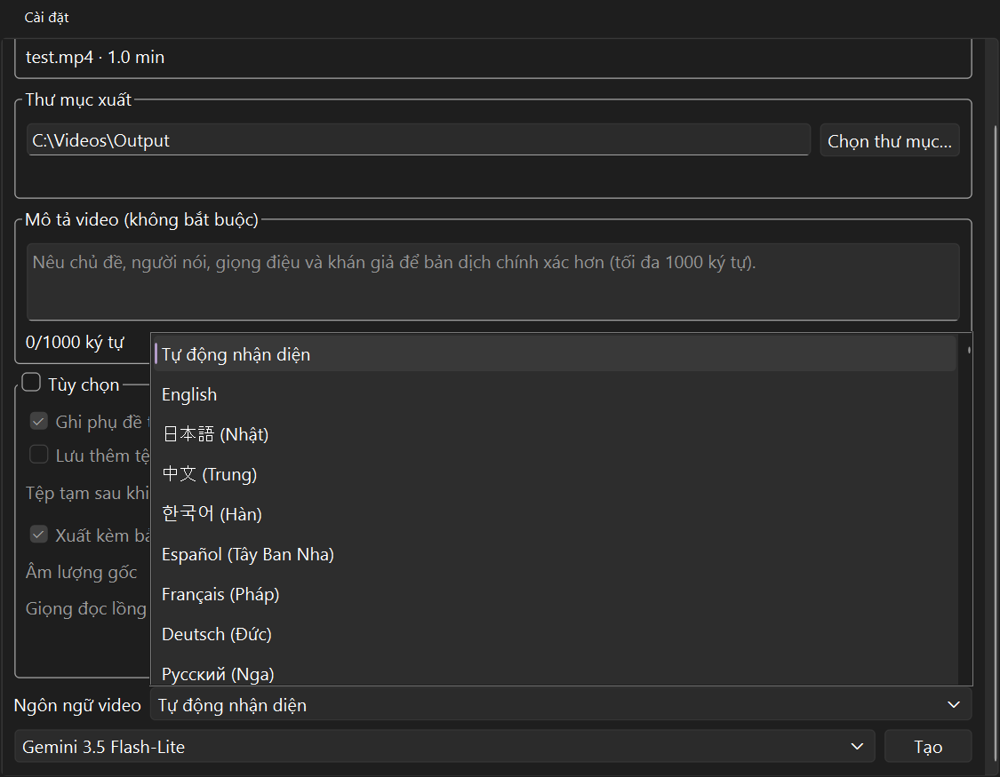

<p align="center">
  
</p>

<h1 align="center">DubTool</h1>

<p align="center">
  <strong>One-click multilingual-to-Vietnamese video dubbing for Windows — local Whisper ASR, free multi-key Auto-Rotate LLM translation (Gemini + Groq), offline VieNeu-TTS v3 voices, streaming audio mixing, and synced Vietnamese subtitles.</strong>
</p>

<p align="center">
  <a href="https://github.com/namtit2932k/dubtool/releases/latest"></a>
  <a href="LICENSE"></a>
  
</p>

<p align="center">
  <strong>English</strong> · <a href="docs/README.vi.md">Tiếng Việt</a>
</p>

<p align="center">
  <a href="https://github.com/namtit2932k/dubtool/releases/latest"></a>
</p>

---

**DubTool** is an open-source Windows desktop app (Python + PySide6, packaged as a standalone portable `.exe`) that turns any foreign-language video — from short clips to multi-hour dramas, courses, or lectures — into a cleanly dubbed Vietnamese video with zero manual subtitle timing.

It automatically detects the video's spoken language (or uses your manual choice), transcribes speech **100% locally** with `faster-whisper`, translates into natural spoken Vietnamese via **Auto-Rotate (Gemini + Groq free keys)** or your chosen LLM (**Gemini**, **Groq**, **OpenAI**, **Anthropic**, or local **Ollama**), synthesizes natural Vietnamese speech **100% offline** using **VieNeu-TTS v3 ONNX**, aligns every sentence to its exact slot, streams and mixes the dub track over the lowered original audio with an anti-clipping limiter, burns synced Vietnamese subtitles, and exports a readable `.docx`/`.txt` translation alongside the final video.

If the input video is already in Vietnamese, DubTool stops before translation and offers to export `.srt` subtitles and a clean transcript with zero API calls.

> ⚖️ Only dub videos you own or have permission to modify. By using DubTool you agree to the [MIT License](LICENSE) and bundled [third-party notices](packaging/THIRD_PARTY.md).

<p align="center">
  
</p>

---

## Key Features

- **Default Free-Tier Auto-Rotate Pool (`auto-rotate`):** Automatically interleaves **all** your saved free **Gemini Flash-Lite** and **Groq (`qwen/qwen3.8-27b`)** API keys across parallel workers (`2` workers by default, `3` when `>= 4` free keys are saved), with adaptive `503` model cooldowns (`15s → 30s → 45s`) and instant `0 ms` failover across keys/providers. Paid providers (OpenAI / Anthropic) are **never** touched in Auto-Rotate mode.
- **Multi-Provider Translation & Quality Guards:** Supports **Gemini**, **Groq Cloud** (free, fast, compact `-67%` prompt & OTPM-safe rotation), **OpenAI**, **Anthropic**, and **Ollama** (100% local), plus cross-provider overload fallback, optional **Video Brief** (to guide tone, genre, and pronouns such as period drama), glossary terms, and automatic rejection/retry of any leaked source-script characters (Chinese Hanzi / Japanese Kana / Korean Hangul).
- **100% Local Speech Recognition & Offline Vietnamese TTS:**
  - **ASR:** `faster-whisper` with VAD, Whisper timestamp drift & internal silence repair (`>= 1.5s`), immediate cancel mid-transcription, and automatic **S1/S2 reuse** when switching translation models.
  - **TTS:** **VieNeu-TTS v3 ONNX** offline on CPU — `v3turbo_int8` (`48 kHz`, 25 natural voices, default *Trúc Ly*) or `v3nano` (`24 kHz`, 11 voices, ~480 MB low-RAM mode), with an instant offline **Voice Preview** button right next to the voice picker. Models download once (~244–269 MB) and work offline forever.
- **Fast Streaming Audio Mixing & Accurate Timing:**
  - **Stage 5 (Fit duration):** Fits clips cleanly into their real slots using gentle `atempo` stretching or targeted LLM shortening + re-TTS (~97% natural `1.0×` fit and `0` overflow on 2.6-hour real-world runs).
  - **Stage 6 (Streaming Mixer):** 30-second block streaming `soundfile` + `numpy` mixer (~20 MB constant RAM, no huge intermediate silence WAV, automatic RF64 support above 3.8 GB, ~15× faster on multi-hour videos) mixed over ducked original audio (`−14 dB` default) with `alimiter`.
- **Crash-Safe, Resumable & Non-Destructive:**
  - Original input videos are **never** overwritten.
  - Every pipeline stage **and** every translation chunk is checkpointed — cancel anytime and click **Tạo** (Generate) again to resume right where you left off.
  - Exports the final dubbed `.mp4`, optional `.srt`, and a side-by-side readable `.docx`/`.txt` translation, with native Windows Explorer file reveal.
- **Secure Key Management:** API keys are stored encrypted in **Windows Credential Manager** (or read-only `.env` for CLI), masked in the UI, redacted from all logs/diagnostics, and never written to `settings.json` or job folders.

---

## Pipeline Architecture (7 Resumable Stages)

| Stage | What it does |
| --- | --- |
| **s1** Extract audio | Extracts mono 16 kHz WAV from the input video via bundled FFmpeg |
| **s2** Transcribe | Local `faster-whisper` with auto language detection, VAD, word-timestamp repair, and instant cancel → `transcript.json` |
| **s3** Translate | Sentence-unit translation with context, brief, glossary, pronoun consistency, CJK-leak guard, chunk checkpoints, and Auto-Rotate / fallback |
| **s4** Text-to-Speech | Offline VieNeu-TTS v3 ONNX (`v3turbo_int8` 48 kHz / `v3nano` 24 kHz) with silence trimming and per-unit WAV cache |
| **s5** Fit duration | Fits each clip to its real slot via gentle `atempo` or LLM shortening + re-TTS without overlapping neighbors |
| **s6** Mix & mux | Streaming 30s-block `soundfile` + `numpy` dub-track render (RF64-safe), ducked original audio (`−14 dB`), and `alimiter` anti-clipping |
| **s7** Subtitles & export | Generates synced `.srt`, burns Vietnamese-safe subtitles (`libass` + bundled Noto Sans), and exports `.docx`/`.txt` readable translation |

---

## Screenshots

| Main Window (Ready) | Language Auto-Detect & Picker |
| :---: | :---: |
|  |  |

| Live Progress & Language Confidence | Running Activity & Cancel Control |
| :---: | :---: |
|  |  |

| Finished Output Actions | Secure API Key Manager |
| :---: | :---: |
|  |  |

---

## Quick Start

### Option 1: Portable Windows App (Recommended)

1. Download the latest `DubTool-*-win64.zip` from [GitHub Releases](https://github.com/namtit2932k/dubtool/releases/latest) and extract it anywhere.
2. Run **`DubTool.exe`** (FFmpeg and Noto Sans Vietnamese fonts are bundled — no Python install needed).
3. Open **Settings → API keys** and add one or more free API keys:
   - [Google AI Studio](https://aistudio.google.com/apikey) (**Gemini** free tier), and/or
   - [Groq Console](https://console.groq.com/keys) (**Groq** free tier — very fast, pairs with Gemini in the default **Auto-Rotate** mode).
   - *(Optional)* Add **OpenAI** or **Anthropic** paid keys if you prefer paid models.
4. Drag & drop a video, optionally add a 1-line **Brief** (e.g. *"Historical Chinese drama, period-style Vietnamese pronouns"*), pick an output folder, and click **Tạo** (Generate).
   - *First run only:* Whisper and VieNeu-TTS ONNX models (~244–269 MB) download automatically into `%LOCALAPPDATA%\DubTool\models\hf_cache`.

### Option 2: Run from Source / CLI

Requires **Python 3.11+** (3.13 recommended) and **FFmpeg on `PATH`**.

```bash
pip install -e .[dev]
copy .env.example .env      # add GEMINI_API_KEY=... and/or GROQ_API_KEY=...
dubtool doctor              # verify FFmpeg, keys, and dependencies
```

**Launch Desktop GUI from source:**

```bash
python -m dubtool.app.main
```

**CLI usage:**

```bash
dubtool run video.mp4 --source-language auto --model auto-rotate --tts-mode v3turbo_int8 --voice "Trúc Ly"
dubtool stage <job_id> <s1..s7> [--force]
dubtool status <job_id>
dubtool retts <job_id> --ids 3,7,12
```

- Pass `--brief "text"` or place `<video>.brief.txt` next to the video to guide genre, tone, and pronouns.
- Copy `glossary.example.json` → `glossary.json` for fixed domain terms (use `"keep original"` to leave a term untranslated).
- See [README_BUILD.md](README_BUILD.md) for packaging `DubTool.exe` from source.

---

## Translation Models & Providers

| Provider | Key / Config | Notes |
| --- | --- | --- |
| **Auto-Rotate** *(default)* | Gemini + Groq keys | Free-tier round-robin across all saved Gemini Flash-Lite & Groq `qwen/qwen3.8-27b` keys; never touches paid keys |
| **Gemini** | `GEMINI_API_KEY` | Free tier (`gemini-3.5-flash-lite`, `gemini-3.1-flash-lite`, `gemini-flash-lite-latest`, `3.6`/`3.8-flash`); strict `json_schema` |
| **Groq Cloud** | `GROQ_API_KEY` | Free tier (`qwen/qwen3.8-27b`, `openai/gpt-oss-120b`, `openai/gpt-oss-20b`); fast inference with multi-key rotation |
| **OpenAI** | `OPENAI_API_KEY` | Paid API (`gpt-5.4-nano`, `gpt-5.4-mini`, `gpt-5.4`, `gpt-5.5`) — asks once before first paid run |
| **Anthropic** | `ANTHROPIC_API_KEY` | Paid API (`claude-haiku-5-5`, `claude-sonnet-5-5`, `claude-opus-5-5`) — asks once before first paid run |
| **Ollama** | `llm_provider: ollama` | 100% local & private; quality depends on local model |

> **Tip for multi-hour videos:** Combining 2+ free Gemini keys (from separate Google Cloud projects) with 1–2 free Groq keys in **Auto-Rotate** mode gives fast, uninterrupted translation even during free-tier `503` or per-minute `429` bursts.

Pipeline defaults (`whisper_model`, `chars_per_sec`, `max_stretch`, `mix`, `subtitles`, `tts`) live in [`config.yaml`](config.yaml) and can be customized from Settings or CLI flags.

---

## Development & Verification

```bash
python -m pytest tests -q                 # 635+ offline tests (no API key or network needed)
python -m dubtool.app.main --selftest     # runtime/FFmpeg/Qt/VieNeu self-check
python -m dubtool.app.main --layout-check # UI geometry & overflow invariants (25 sizes x states)
python -m dubtool.app.main --gui-smoke    # isolated real-widget end-to-end smoke test
```

Release history and detailed update reports live in [`docs/RELEASES.md`](docs/RELEASES.md) (latest report: [`REPORT_UPDATE_19.md`](docs/reports/REPORT_UPDATE_19.md)).

---

## Privacy & License

- **Privacy:** Speech recognition (`faster-whisper`), Vietnamese TTS (`VieNeu-TTS v3 ONNX`), audio mixing, and subtitle rendering run **100% locally** on your PC. Only the recognized source-language text is sent to the translation provider you select. API keys live in Windows Credential Manager (or `.env`) and are never logged.
- **License:** [MIT License](LICENSE) — Copyright (c) 2026 sickyturtlez. Bundled third-party components (FFmpeg GPL v3, PySide6 LGPL v3, faster-whisper, VieNeu-TTS, sea-g2p, soundfile, Noto Sans) retain their respective licenses; see [`packaging/THIRD_PARTY.md`](packaging/THIRD_PARTY.md).
