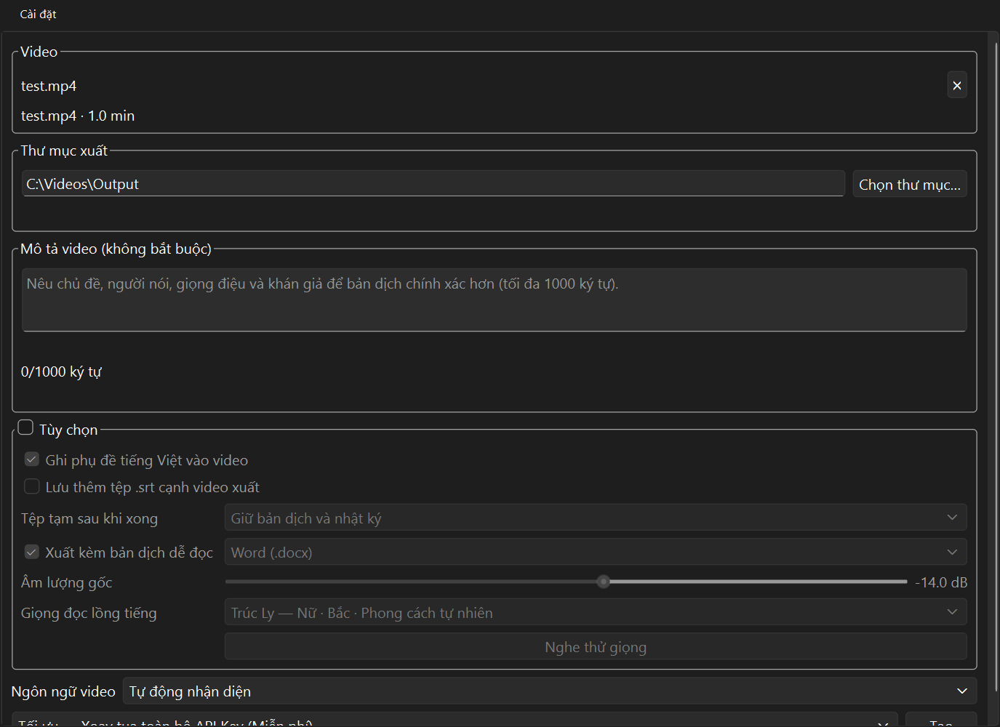
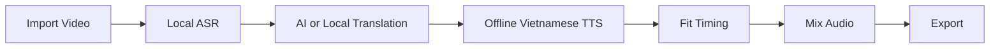

<p align="center">
  
</p>

<p align="center">
  <a href="https://github.com/namtit2932k/dubtool/releases/latest"></a>
  <a href="https://github.com/namtit2932k/dubtool/actions/workflows/ci.yml"></a>
  <a href="LICENSE"></a>
  
</p>

<p align="center">
  <strong>English</strong> · <a href="docs/README.vi.md">Tiếng Việt</a>
</p>

<p align="center">
  <a href="https://github.com/namtit2932k/dubtool/releases/latest"></a>
</p>

---

## 🎬 Overview

**DubTool** turns foreign-language videos into Vietnamese-dubbed videos with synchronized subtitles. It combines local speech recognition, context-aware AI translation, offline Vietnamese speech synthesis, automatic audio timing, and a resumable media-processing pipeline in a portable Windows desktop app (Python + PySide6, packaged as a standalone `.exe` with a full CLI).

- **Input:** Foreign-language videos from short clips to multi-hour lectures, tutorials, or dramas — your original input file is **never** modified or overwritten.
- **Output:** A dubbed Vietnamese **`.mp4`** video with original audio ducked underneath, synchronized **`.srt`** subtitles and/or burned-in subtitles (configurable), plus a side-by-side readable **`.docx` / `.txt`** translation.
- **Vietnamese-source guard:** If the input video is already in Vietnamese, DubTool stops before translation and offers to export `.srt` subtitles and a clean transcript with no translation API calls.

> ⚖️ Only dub videos you own or have permission to modify. By using DubTool you agree to the [MIT License](LICENSE) and bundled [third-party notices](packaging/THIRD_PARTY.md).

---

## 🖥️ Screenshots

*Click any screenshot to inspect it at full resolution.*

### Main Interface

| Ready to Dub (Source Language & Model Picker) | Source-Language Auto-Detect & Selector |
| :---: | :---: |
| [](docs/images/ready.png)<br><sub>Drag & drop a video, pick a model or Auto-Rotate, and configure subtitles</sub> | [](docs/images/lang_dropdown_open.png)<br><sub>Automatic spoken-language detection, curated languages, and Other…</sub> |

### Processing & Live Activity

| Detected Language & Confidence | Live Progress & Instant Cancel |
| :---: | :---: |
| [](docs/images/details_detected_language.png)<br><sub>Displays recognized language, confidence score, and stage details</sub> | [](docs/images/running.png)<br><sub>Stage progress bar, cancel control, and live activity log</sub> |

### Results & Settings

| Finished Output Actions | Secure API Key Manager |
| :---: | :---: |
| [](docs/images/finished.png)<br><sub>Open output folder, play dubbed video, or open readable translation</sub> | [](docs/images/settings_api_keys.png)<br><sub>Masked keys stored in Windows Credential Manager with live key tester</sub> |

---

## ⚙️ How It Works



1. **Import & Transcribe:** Detects the spoken language (or uses your manual choice) and transcribes speech locally with `faster-whisper`.
2. **Translate & Synthesize:** Translates complete sentences into natural spoken Vietnamese with optional context, then generates Vietnamese voice clips offline on CPU.
3. **Fit, Mix & Export:** Aligns every dubbed clip to its speech slot, ducks the original audio with an anti-clipping limiter, and exports the final `.mp4`, optional `.srt`, and readable `.docx`/`.txt`.

---

## ✨ Why DubTool

<table>
  <tr>
    <td width="50%" valign="top">
      <h3>🌐 Smart Translation &amp; Auto-Rotate</h3>
      <p><strong>Keep long translations moving using your free API keys.</strong> Default <code>auto-rotate</code> mode interleaves all saved free <strong>Gemini</strong> and <strong>Groq</strong> keys across parallel workers, switching immediately to another ready key or provider on <code>503</code>/<code>429</code> without waiting out cooldowns. Paid <strong>OpenAI</strong>/<strong>Anthropic</strong> keys are never used automatically. Supports optional <strong>Video Brief</strong>, <strong>Glossary</strong>, pronoun consistency, and CJK-leak rejection.</p>
    </td>
    <td width="50%" valign="top">
      <h3>🔒 Local ASR &amp; Offline Vietnamese TTS</h3>
      <p><strong>Run speech processing on your own PC without TTS API limits.</strong> <code>faster-whisper</code> handles local ASR with VAD, timestamp repair, and mid-stage cancel. <strong>VieNeu-TTS v3 ONNX</strong> synthesizes natural Vietnamese on CPU (<code>v3turbo_int8</code> 48 kHz / 25 voices or low-RAM <code>v3nano</code> 24 kHz / 11 voices) with a built-in <strong>Voice Preview</strong> — works offline after the one-time ~244–269 MB model download.</p>
    </td>
  </tr>
  <tr>
    <td width="50%" valign="top">
      <h3>🚀 Built for Long-Form Video</h3>
      <p><strong>Cancel safely and resume multi-hour jobs without starting over.</strong> Every pipeline stage (<code>s1</code>–<code>s7</code>) and translation chunk is checkpointed on disk, and switching translation models automatically reuses existing <code>s1</code>/<code>s2</code> outputs. A 30-second block streaming <code>soundfile</code> + <code>numpy</code> mixer keeps memory bounded and enables RF64 automatically above 3.8 GB.</p>
    </td>
    <td width="50%" valign="top">
      <h3>🎧 Precise Audio &amp; Subtitle Output</h3>
      <p><strong>Balanced dub audio and subtitles matched to actual playback.</strong> Fits each clip to its real window via gentle <code>atempo</code> or targeted LLM shortening + re-TTS so lines do not overlap. Lowers original audio (<code>−14 dB</code> default) with <code>alimiter</code>, generates synced <code>.srt</code>, optionally burns Vietnamese subtitles via <code>libass</code> + Noto Sans, and exports <code>.docx</code>/<code>.txt</code>.</p>
    </td>
  </tr>
  <tr>
    <td width="50%" valign="top">
      <h3>🛡️ Privacy &amp; Safe Key Handling</h3>
      <p><strong>Clear separation between local media processing and cloud text translation.</strong> ASR, TTS (after initial download), mixing, and subtitling run locally; cloud translation sends only the recognized source transcript plus optional Brief/Glossary to your chosen provider. Use <strong>Ollama</strong> for fully local translation. Desktop API keys live in <strong>Windows Credential Manager</strong> and are redacted from logs.</p>
    </td>
    <td width="50%" valign="top">
      <h3>🧪 Automated Engineering Verification</h3>
      <p><strong>Tested like a real desktop product, not a one-off script.</strong> Windows CI verifies Python 3.11 &amp; 3.13, an automated offline test suite (no real API keys), runtime self-checks, UI layout invariants, isolated GUI smoke tests, and packaged executable builds from clean git archives.</p>
    </td>
  </tr>
</table>

---

## 🧩 Pipeline Architecture

DubTool runs **7 resumable stages** (`s1`–`s7`), followed by a post-pipeline readable document export (`s8_export_readable.py`):

| Stage | Responsibility |
| --- | --- |
| **s1** Extract audio | Extracts mono 16 kHz WAV from the input video via bundled FFmpeg |
| **s2** Transcribe | Local `faster-whisper` ASR with auto language detection, VAD, timestamp repair, and cancel support |
| **s3** Translate | Chunked sentence translation with context, brief, glossary, pronoun consistency, and CJK-leak checks |
| **s4** Text-to-Speech | Offline `VieNeu-TTS v3 ONNX` synthesis with silence trimming and per-unit WAV cache |
| **s5** Fit duration | Fits clips cleanly into their slots via gentle `atempo` or LLM shortening + re-TTS |
| **s6** Mix & mux | 30s-block streaming dub-track mix (`soundfile` + `numpy`, RF64-safe) over ducked original audio + `alimiter` |
| **s7** Subtitles & mux | Generates synced `.srt` and optionally burns Vietnamese subtitles (`libass` + bundled Noto Sans) |
| *Post-pipeline* Export | Writes the side-by-side readable `.docx` / `.txt` translation next to the output video |

See [`docs/ARCHITECTURE.md`](docs/ARCHITECTURE.md) for module boundaries, resume hashing, and LLM resilience details.

---

## 📦 Quick Start

### Option 1: Portable Windows App (Recommended)

1. Download the latest `DubTool-*-win64.zip` from [GitHub Releases](https://github.com/namtit2932k/dubtool/releases/latest) and extract it to any folder.
2. Launch **`DubTool.exe`** (FFmpeg and Noto Sans Vietnamese font are bundled — no Python installation required).
3. Open **Settings → API keys** and add one or more free API keys:
   - [Google AI Studio](https://aistudio.google.com/apikey) (**Gemini** free tier), and/or
   - [Groq Console](https://console.groq.com/keys) (**Groq** free tier — pairs with Gemini in the default **Auto-Rotate** mode).
   - *(Optional)* Add **OpenAI** or **Anthropic** paid keys, or configure local **Ollama**.
4. Drag & drop a video, optionally enter a short **Brief** (e.g., genre and preferred Vietnamese pronouns), choose an output folder, and click **Tạo** (Generate).
   - *First run only:* Whisper ASR and VieNeu-TTS ONNX models (~244–269 MB) download automatically to `%LOCALAPPDATA%\DubTool\models\hf_cache`; subsequent ASR/TTS runs work offline.

### Option 2: Run from Source / CLI

Requires **Python 3.11+** (**3.13 x64** recommended) and **FFmpeg on `PATH`**.

```bash
pip install -e ".[gui,dev]"             # CLI + Desktop GUI (PySide6-Essentials, keyring) + pytest
pip install --no-deps "vieneu>=3.8,<4"  # VieNeu-TTS v3 ONNX (avoids pulling optional WebUI/gradio extras)
copy .env.example .env                  # add GEMINI_API_KEY=... and/or GROQ_API_KEY=...
dubtool doctor                          # verify FFmpeg, keys, and dependencies
```

**Launch the Desktop GUI:**

```bash
python -m dubtool.app.main
```

**Run from the CLI:**

```bash
dubtool run video.mp4 --source-language auto --model auto-rotate --tts-mode v3turbo_int8 --voice "Trúc Ly"
dubtool stage <job_id> <s1..s7> [--force]
dubtool status <job_id>
dubtool retts <job_id> --ids 3,7,12
```

- Pass `--brief "text"` or place `<video>.brief.txt` beside the input video to guide tone and pronouns.
- Copy `glossary.example.json` → `glossary.json` for domain terms (use `"keep original"` to leave a term untranslated).
- See [`README_BUILD.md`](README_BUILD.md) for packaging `DubTool.exe` from source.

---

## 🌐 Translation Providers

| Provider | Tier / Mode | Configuration | Role |
| --- | --- | --- | --- |
| **Auto-Rotate** *(default)* | Free tier | Saved Gemini + Groq keys | Rotates all saved free Gemini and Groq keys on overload/rate limits; never uses paid keys |
| **Gemini** | Free tier | `GEMINI_API_KEY` | Structured JSON translation across supported Gemini models |
| **Groq Cloud** | Free tier | `GROQ_API_KEY` | Fast inference with compact prompts and multi-key rotation |
| **OpenAI** | Paid API | `OPENAI_API_KEY` | Optional paid models; prompts once before the first paid run |
| **Anthropic** | Paid API | `ANTHROPIC_API_KEY` | Optional paid Claude models; prompts once before the first paid run |
| **Ollama** | Local | `llm_provider: ollama` | Fully local translation with no cloud requests |

The full supported model catalog lives in [`packaging/models.yaml`](packaging/models.yaml), and default pipeline settings live in [`config.yaml`](config.yaml).

---

## 🧪 Engineering & Reliability

DubTool uses automated GitHub Actions verification on Windows (`.github/workflows/ci.yml`):

- **Multi-version matrix:** Runs on **Windows Python 3.11** (dependency compatibility check via `pyproject.toml`) and **Windows Python 3.13** (reproducible lockfile environment via [`packaging/requirements-lock.txt`](packaging/requirements-lock.txt)).
- **Offline verification gates:** Runs the automated offline test suite, runtime `--selftest`, UI geometry `--layout-check`, and isolated `--gui-smoke` without requiring real API keys.
- **Release artifact verification:** Builds `DubTool.exe` from a clean `git archive` via [`packaging/build_exe.ps1`](packaging/build_exe.ps1), verifies pinned SHA-256 vendor assets ([`packaging/vendor_manifest.json`](packaging/vendor_manifest.json)), checks release ZIP CRC/SHA-256 and `BUILD_INFO.txt` provenance, and executes the smoke checks from the extracted ZIP executable.

Run verification locally:

```bash
python -m pytest tests -m "not packaged" -q   # automated offline test suite (no API key needed)
python -m dubtool.app.main --selftest         # FFmpeg, Qt, VieNeu, and provider SDK self-check
python -m dubtool.app.main --layout-check     # UI geometry & overflow invariants (25 sizes x states)
python -m dubtool.app.main --gui-smoke        # isolated real-widget end-to-end smoke test
```

Documentation: [`docs/ARCHITECTURE.md`](docs/ARCHITECTURE.md) · [`docs/RELEASES.md`](docs/RELEASES.md) · [`README_BUILD.md`](README_BUILD.md) · [`REPORT_UPDATE_19.md`](docs/reports/REPORT_UPDATE_19.md)

---

## 🛡️ Privacy & License

- **Privacy:** Speech recognition (`faster-whisper`), Vietnamese TTS (`VieNeu-TTS v3 ONNX`, after initial model download), audio mixing, and subtitle rendering run locally on your PC. When using a cloud translation provider, only the recognized source-language transcript text and optional user-provided context (Video Brief and Glossary entries) are sent to the provider you select. For fully local translation, choose **Ollama**. API keys are stored in Windows Credential Manager (or `.env`) and are never logged.
- **License:** [MIT License](LICENSE) — Copyright (c) 2026 sickyturtlez. Bundled third-party components (FFmpeg GPL v3, PySide6 LGPL v3, faster-whisper, VieNeu-TTS, sea-g2p, soundfile, Noto Sans) retain their respective licenses; see [`packaging/THIRD_PARTY.md`](packaging/THIRD_PARTY.md).
