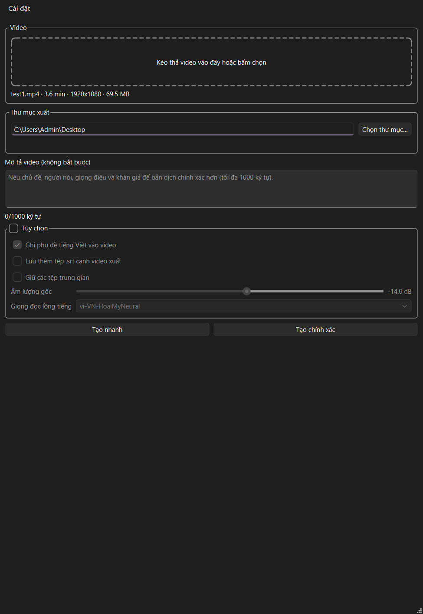
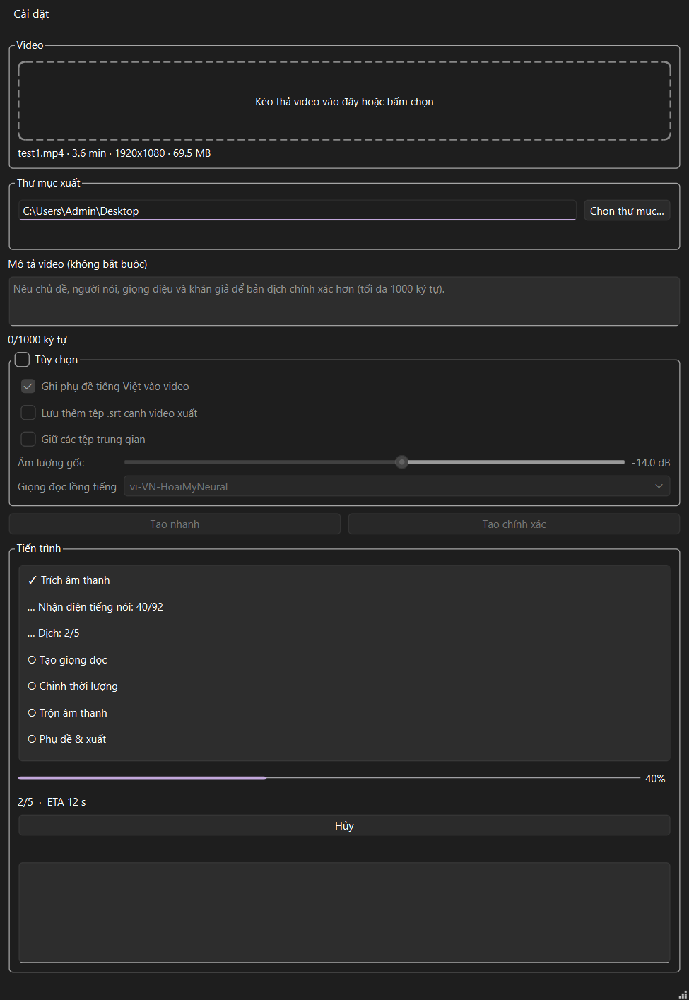

# DubTool — English → Vietnamese video dubbing

DubTool takes an English-speaking video, transcribes it locally, translates it to
Vietnamese with an LLM, generates a Vietnamese voice with TTS, fits the speech
into the original timing, mixes it over the original audio, and burns Vietnamese
subtitles — ending in a dubbed MP4.

It ships as a **command-line tool** for full control over every stage, and
(staged, in development) as a **Windows desktop app** with two one-click
modes: *Fast* and *Accurate*.

> Only dub videos you own or have permission to modify.



## How it works

Seven resumable stages, all driven by the same code from the CLI and the app:

| Stage | What it does |
| --- | --- |
| s1 extract audio | mono 16 kHz WAV from the input video (FFmpeg) |
| s2 transcribe | faster-whisper (local, no upload) → `transcript.json`, then cleanup: merges too-short segments, splits too-long ones, dedupes boundary repeats |
| s3 translate | Gemini (pluggable) sentence-level units with context, glossary, optional video brief, pronoun consistency, then an enforcement pass on segments over the character budget |
| s4 text-to-speech | edge-tts Vietnamese voices with silence trimming and a content-addressed clip cache |
| s5 fit duration | stretch (atempo), LLM shortening with re-TTS, or overflow — never silently rewrites a reviewed translation |
| s6 mix and mux | lowers the original audio (default −14 dB), places clips on the schedule, never lets Vietnamese clips overlap, closes with `alimiter` |
| s7 burn subtitles | SRT + libass burn, Vietnamese-safe font sizing, temp file + atomic replace |

Every JSON write is atomic; every stage is idempotent — rerun anything with
`--force`, resume everything else for free.

## Setup

Requires **Python 3.11+** and **FFmpeg on `PATH`**.

```bash
pip install -e .[dev]
copy .env.example .env      # then put your GEMINI_API_KEY in .env
```

Get a free key at [Google AI Studio](https://aistudio.google.com/apikey) — no
card needed. Optional extra keys `GEMINI_API_KEY_2`, `GEMINI_API_KEY_3` spread
one key's free-tier daily quota; the pipeline rotates automatically on 429.

Check your environment (FFmpeg, key, deps):

```bash
dubtool doctor
```

## Command-line usage

```bash
dubtool run sample.mp4 [--mode fast|accurate via config] [--voice vi-VN-HoaiMyNeural] [--whisper-model small] [--force]
dubtool stage <job_id> <s1..s7> [--force]
dubtool status <job_id>
dubtool retts <job_id> --ids 3,7,12
dubtool compare-translate <job_id> --models gemini:gemini-3.5-flash-lite,gemini:gemini-3.8-flash
dubtool review-zip
```

- `run` copies the video into `jobs/<job_id>/`, runs all stages, and writes the
  final MP4 plus `output.vi.srt` and useful intermediates
  (`transcript.json`, `translated.json`, `tts/`, `fitted/`, `schedule.json`).
- `stage` re-runs a single stage; the job directory is the resume unit.
- A video description helps the translator: pass `--brief "text"` or keep a
  `<video>.brief.txt` next to the video (topic, speaker, tone, audience).
- Optional terminology: copy `glossary.example.json` → `glossary.json`.

### Translation providers

| Provider | Config | Notes |
| --- | --- | --- |
| **Gemini** (default) | `llm_provider: gemini` | free tier; may use submitted content to improve products |
| Ollama | `llm_provider: ollama` | local + private; Vietnamese quality varies by model |
| Anthropic | `llm_provider: anthropic` | paid; `ANTHROPIC_API_KEY` in `.env` |

Model IDs live in `config.yaml` (and, for the app, in `packaging/modes.yaml`):
**Fast** = `gemini-3.5-flash-lite`, **Accurate** = `gemini-3.8-flash`.
Translate chunks run independently and can be parallelized with
`translate.concurrency` (accurate mode: 3).

## Desktop app (Windows, in development)

```bash
pip install PySide6 keyring
python -m dubtool.app.main            # GUI (Vietnamese by default, English in Settings)
python -m dubtool.app.main --selftest # offline checks: FFmpeg/libass/libx264/font/keyring/Qt
python -m dubtool.app.main --screenshots shots/  # render UI states as PNGs
python -m dubtool.app.main --headless-run video.mp4 outdir/ --mode fast
```

- Drop a video, pick an output folder, press **Tạo nhanh** (fast) or
  **Tạo chính xác** (accurate) — or follow the staged progress with cancel,
  resume, and start-over.
- The Gemini key is stored in **Windows Credential Manager** (keyring), never
  in `settings.json`, logs, or the job folder.
- Audio/video never leaves the machine except: English transcript text → Google
  (translation), Vietnamese text → Microsoft's speech service (edge-tts,
  unofficial interface) for the voice.



## Configuration

`config.yaml` holds the tunables you are most likely to touch:
`whisper_model`, `chars_per_sec` (speech-rate budget, re-measured on trimmed
clips), `max_stretch`, `mix` (mode, original gain, limiter), `subtitles`
(size, margin, font), `translate.concurrency` and `translate.pronouns`.
Everything is also overridable per command line; run `dubtool run --help`.

## Development

```bash
py -m pytest            # 185 offline tests; providers mocked, no key needed
py -m dubtool doctor    # environment sanity check
```

Key internals:

- `src/dubtool/api.py` — `run_dub()`: the library entry the app and CLI share
  (mode resolution, stable job id, cancel between segments/stages, atomic
  output delivery, no silent overwrite).
- `src/dubtool/app/` — desktop app package: settings, secrets (keyring),
  modes (fast/accurate), i18n (vi/en), worker service, error mapping,
  diagnostics export, selftest.
- `agent/` — development session notes and specs (AGENT.md …), kept for
  history; the pipeline itself does not read them.

## Privacy

- Speech recognition runs locally (faster-whisper); audio/video stays on disk.
- Transcript text is sent to the configured LLM provider for translation.
- On free tiers, providers may use submitted content to improve their products.
- The API key lives in `.env` (CLI) or Windows Credential Manager (app) and is
  never printed, logged, or written into job artifacts.

## License

Application code: see `LICENSE` (to be added). Bundled runtime components —
FFmpeg (GPL build compliance note in `packaging/THIRD_PARTY.md`), faster-whisper
models, edge-tts voices, Qt — keep their own licenses and are **not** committed
to this repository.
