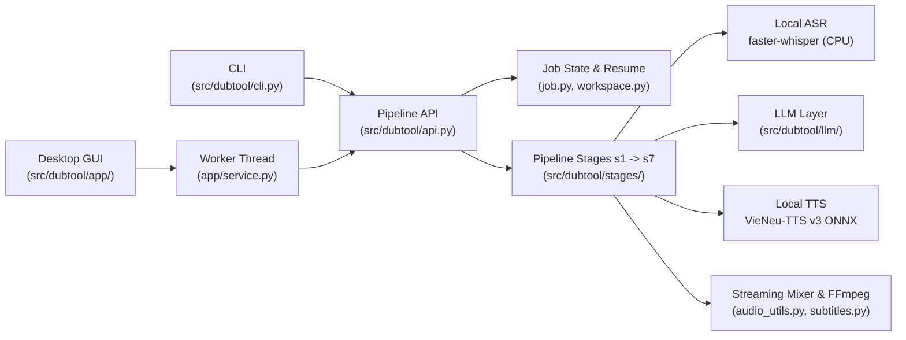
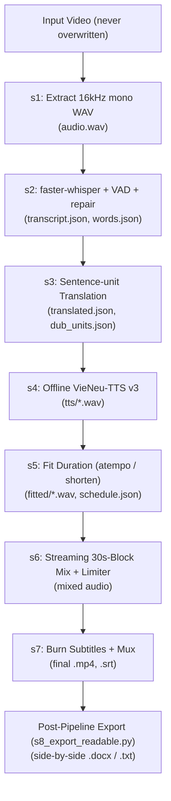

# DubTool Architecture & Contributor Guide

This document summarizes DubTool's runtime architecture, pipeline contracts, LLM resilience design, security boundaries, and testing tiers so contributors can understand and work on the codebase without reading historical update logs.

---

## 1. High-Level System Overview

DubTool is a Windows 10/11 desktop application (Python + PySide6-Essentials, packaged with PyInstaller) with a shared headless CLI (`dubtool`). Both the GUI and the CLI execute the exact same pipeline entry point (`dubtool.api.run_dub`).



### Module Boundaries

| Layer | Location | Responsibility |
| --- | --- | --- |
| **Shared Pipeline API** | `src/dubtool/api.py`, `config.py`, `job.py`, `workspace.py` | Config loading, stable job IDs, atomic JSON persistence, dependency hashes, cancellation, and stage orchestration |
| **Pipeline Stages** | `src/dubtool/stages/s1..s7` | Seven resumable, hash-tracked stages (`job.STAGE_ORDER`: `s1` extract, `s2` transcribe, `s3` translate, `s4` TTS, `s5` fit duration, `s6` streaming mix, `s7` subtitles & mux) |
| **Post-Pipeline Export** | `src/dubtool/stages/s8_export_readable.py` | Post-pipeline readable `.docx`/`.txt` translation export invoked by `api.run_dub` after `s1..s7` complete (not part of `STAGE_ORDER` state tracking) |
| **LLM Abstraction** | `src/dubtool/llm/` | Provider adapters (`auto_rotate`, `gemini`, `groq`, `openai`, `anthropic`, `ollama`), catalog (`packaging/models.yaml`), `LLMClient` retry/circuit-breaker/split logic, `KeyPool`, `quota_state`, JSON & CJK-leak validation |
| **Offline TTS** | `src/dubtool/tts/vieneu.py` | Lazy-loaded VieNeu-TTS v3 ONNX (`v3turbo_int8` 48 kHz / `v3nano` 24 kHz), HF cache routing, audio sanity checks, deterministic silence trimming |
| **Media & Subtitles** | `src/dubtool/audio_utils.py`, `subtitles.py`, `punctuate.py`, `dub_units.py` | FFmpeg subprocess wrapper, 30s-block `soundfile` + `numpy` streaming mixer (RF64-safe), Whisper timestamp repair, Vietnamese-safe ASS/SRT generation |
| **Desktop App (GUI)** | `src/dubtool/app/` | PySide6 UI (`ui/main_window.py`, `ui/settings_dialog.py`), `i18n/` (`vi.py`, `en.py`), Windows Credential Manager (`secrets.py`), offline voice preview (`voice_preview.py`), diagnostics & redaction (`diagnostics.py`, `failguard.py`), self-checks (`selftest.py`, `layout_check.py`) |

---

## 2. Pipeline Stages & Resume Contract



> **Note on `STAGE_ORDER`:** `job.STAGE_ORDER` tracks exactly the seven resumable stages `["s1", "s2", "s3", "s4", "s5", "s6", "s7"]`. Readable `.docx`/`.txt` generation (`s8_export_readable.py`) runs as a post-pipeline export step in `api.run_dub` once `s1..s7` finish, rather than as a stateful stage inside `STAGE_ORDER`.

### Key Persistence & Recovery Invariants

1. **Non-destructive input:** Input videos are never modified or overwritten.
2. **Stable job ID (`api._stable_job_id`):** Derived from the input video identity and language/ASR settings — intentionally excludes `provider:model` so switching translation models reuses completed **S1/S2** (Whisper) outputs.
3. **Atomic writes (`job.write_json`):** All state and JSON artifacts are written to a temporary file and atomically moved via `os.replace`.
4. **Dependency-aware resume (`job.stage_inputs_hash`):** Each stage stores a hash of its upstream artifacts and relevant config. Unchanged completed stages are skipped; changing voice/model/brief invalidates only downstream stages.
5. **Chunk-level translation checkpoints (`translate_chunks.json`):** Completed translation chunks are persisted immediately so cancelling mid-S3 resumes from the next untranslated chunk.
6. **Cancellation (`threading.Event`):** Checked across S2 Whisper collection, S3 LLM waits/retries, S4 TTS synthesis, S5 shortening, S6 streaming mixer blocks, and FFmpeg subprocesses.

---

## 3. LLM Resilience & Free-Tier Auto-Rotate

- **Default Model (`auto-rotate`):** `AutoRotateProvider` interleaves all saved free-tier **Gemini Flash-Lite** (`gemini-3.5-flash-lite`, `gemini-3.1-flash-lite`, `gemini-flash-lite-latest`) and **Groq** (`qwen/qwen3.8-27b`) keys in a single round-robin pool. Paid providers (`openai`, `anthropic`) are never included.
- **Failure handling:**
  - `503` (model-wide overload): adaptive per-model cooldown (`15s → 30s → 45s`, reset on success) with immediate `0 ms` rotation to another provider/key.
  - `429` (minute TPM/RPM): per-slot cooldown only; daily quota exhaustion marks that `(key, model)` dead for the day (persisted by key fingerprint in `quota_state.py`).
  - `401`/`403`: permanently disables all slots for the invalid key.
  - Truncated JSON / `MAX_TOKENS` (`RequestTooLargeError`): Groq length limits hand off to a ready Gemini slot (8,000-token cap); otherwise `LLMClient` splits the chunk in two once without tripping overload fallback.
  - Untranslated CJK/Kana/Hangul leakage (`parsing.check_no_untranslated_cjk`): rejected at validation and retried automatically (respecting `"keep original"` glossary entries).

---

## 4. Security & Privacy Boundaries

- **Local-only media:** Video decoding, audio extraction, Whisper ASR, VieNeu-TTS synthesis, streaming audio mixing, and subtitle rendering execute locally on the user's machine.
- **Cloud scope:** Only recognized source-language transcript text (plus optional user-provided brief/glossary) is sent to the selected translation provider.
- **Key storage:** Desktop API keys live in **Windows Credential Manager** (`dubtool.app.secrets`); CLI supports read-only `.env` fallback. Keys are never written to `settings.json`, job files, or logs, and are masked/redacted in UI panels and diagnostics exports (`tests/test_no_leak.py`, `scripts/preflight_gates.py`).

---

## 5. Testing Tiers & Developer Commands

Tests are organized by scope and registered with pytest markers in `pyproject.toml`:

| Tier | Command | What it covers |
| --- | --- | --- |
| **Fast unit / logic** | `python -m pytest tests/test_auto_rotate.py tests/test_groq_provider.py tests/test_s3_optimizations.py tests/test_dependencies_sync.py -q` | Provider adapters, parsing, CJK guard, streaming mixer, dependency sync (~2 s) |
| **Full offline suite (CI)** | `python -m pytest tests --ignore=tests/test_screenshots.py -q --timeout=120 -rs` | 635+ offline unit, integration, security, and PySide6 widget tests (0 API keys) |
| **Static & repo gates** | `python scripts/preflight_gates.py && python scripts/check_readme_links.py` | Secret leak scan, file size / forbidden path checks, README link integrity |
| **GUI & runtime checks** | `python -m dubtool.app.main --selftest && python -m dubtool.app.main --layout-check && python -m dubtool.app.main --gui-smoke` | FFmpeg/Qt/VieNeu check, 25 size×state overflow checks, isolated real-widget E2E smoke |
| **Packaged release** | `python scripts/release.py <N>` | Clean `git archive` build, `.exe` verification, screenshots, 9-rule DoD, GitHub release & `verify_release.py --audit` |

### Debugging a Single Stage

```bash
dubtool status <job_id>            # inspect stage status and hashes
dubtool stage <job_id> s3 --force  # re-run only translation on an existing job
dubtool retts <job_id> --ids 5,12  # re-synthesize specific segments
```
