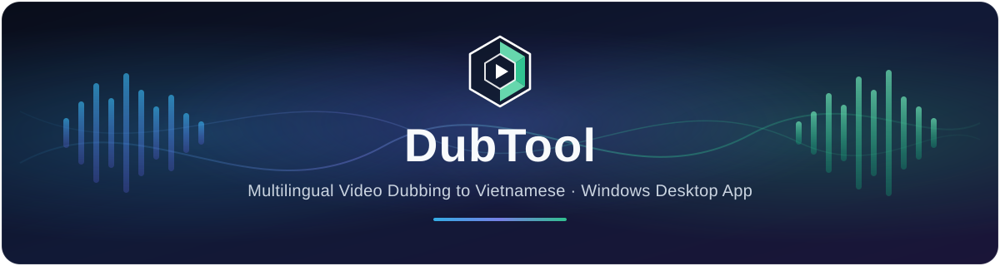
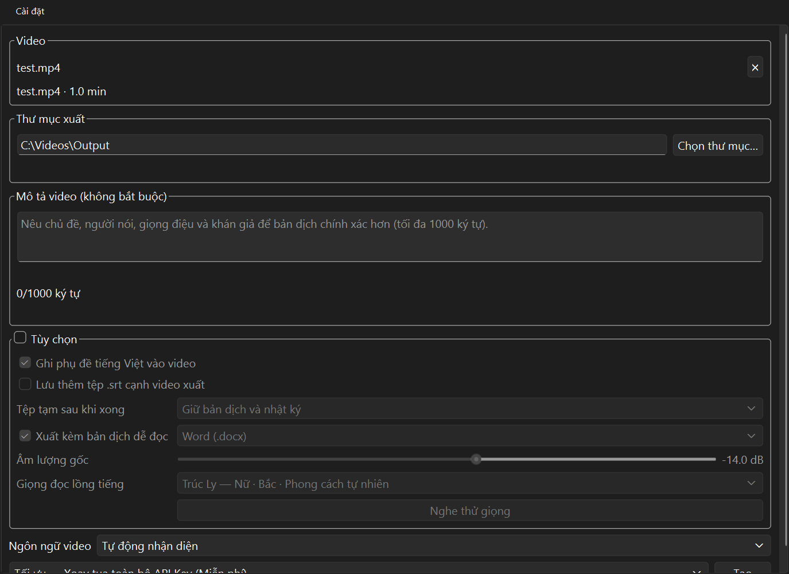
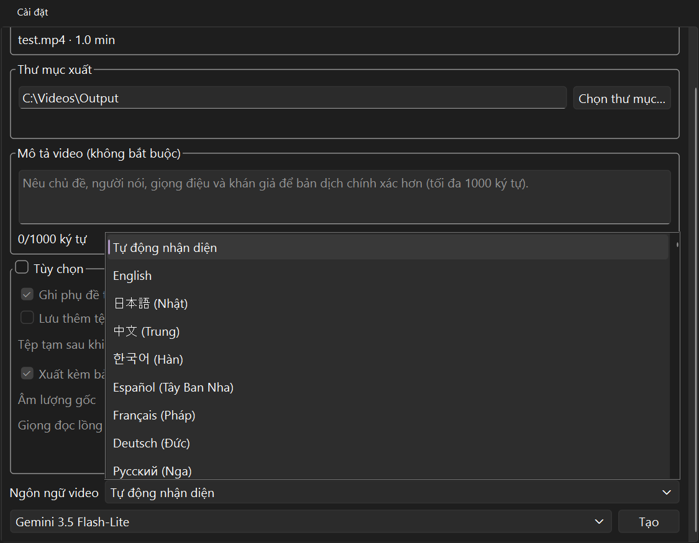
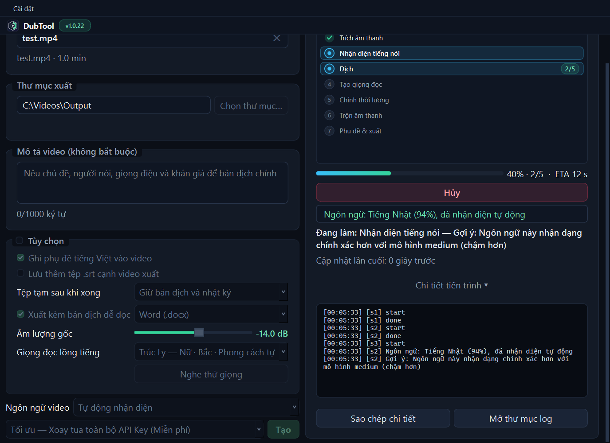
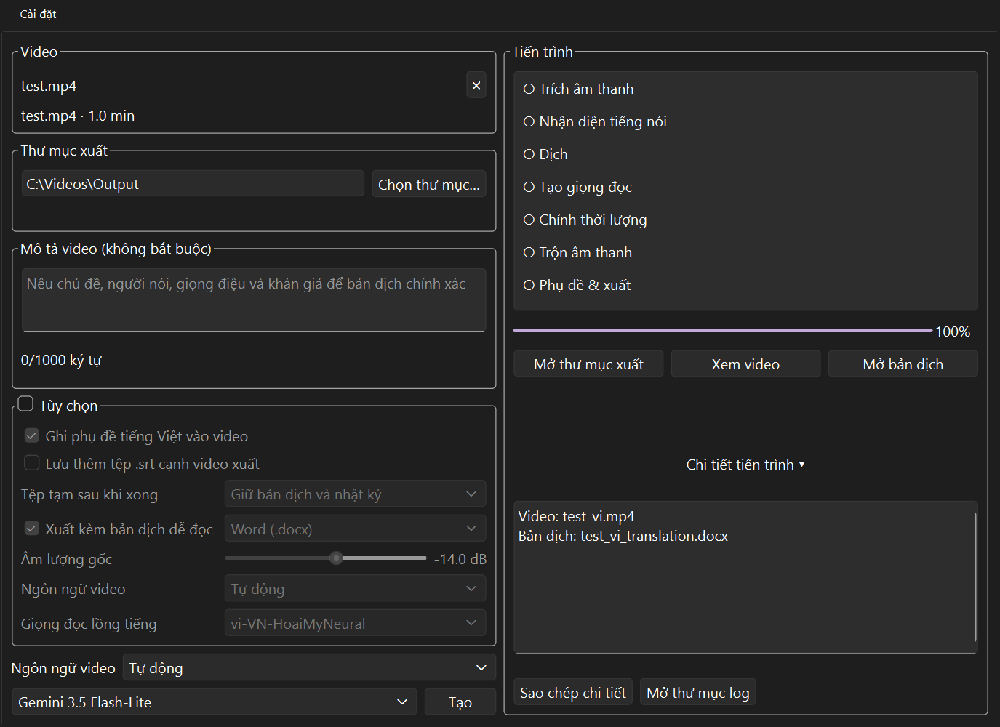
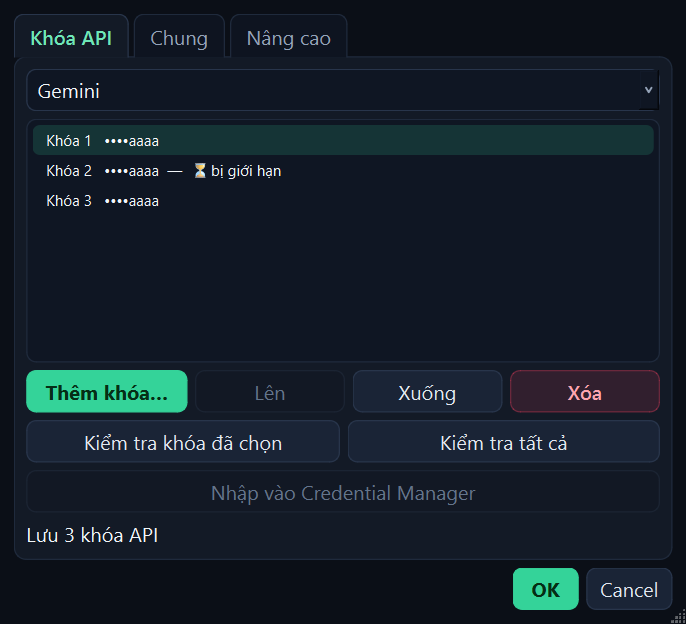
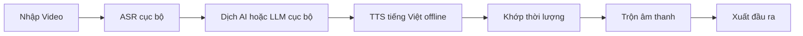

<p align="center">
  
</p>

<p align="center">
  <a href="https://github.com/namtit2932k/dubtool/releases/latest"></a>
  <a href="https://github.com/namtit2932k/dubtool/actions/workflows/ci.yml"></a>
  <a href="../LICENSE"></a>
  
</p>

<p align="center">
  <a href="../README.md">English</a> · <strong>Tiếng Việt</strong>
</p>

<p align="center">
  <a href="https://github.com/namtit2932k/dubtool/releases/latest"></a>
</p>

---

## 🎬 Tổng quan

**DubTool** chuyển video ngoại ngữ thành video lồng tiếng Việt kèm phụ đề đồng bộ. Ứng dụng kết hợp nhận diện tiếng nói cục bộ, dịch AI theo ngữ cảnh, tổng hợp giọng đọc tiếng Việt offline, tự động căn khớp thời lượng âm thanh và pipeline xử lý có thể tiếp tục bất cứ lúc nào — tất cả trong một ứng dụng Windows portable (Python + PySide6, đóng gói thành `.exe` độc lập kèm CLI đầy đủ).

- **Đầu vào:** Video ngoại ngữ từ clip ngắn đến bài giảng, hướng dẫn hay phim dài nhiều giờ — tệp video gốc **không bao giờ** bị sửa hay ghi đè.
- **Đầu ra:** Video **`.mp4`** lồng tiếng Việt với nền gốc đã hạ âm lượng, phụ đề tiếng Việt **`.srt`** và/hoặc phụ đề gắn cứng vào video (tùy chọn bật/tắt), cùng tệp bản dịch song ngữ dễ đọc **`.docx` / `.txt`**.
- **Bảo vệ video tiếng Việt:** Nếu video đầu vào đã là tiếng Việt, DubTool tự dừng trước bước dịch và đề xuất xuất phụ đề `.srt` cùng bản chép lời mà không gọi API dịch.

> ⚖️ Chỉ lồng tiếng video bạn sở hữu hoặc có quyền chỉnh sửa. Khi tải và sử dụng DubTool, bạn đồng ý với [Giấy phép MIT](../LICENSE) và các [thông báo bên thứ ba](../packaging/THIRD_PARTY.md).

---

## 🖥️ Ảnh chụp màn hình

*Nhấn vào từng ảnh để xem ở độ phân giải đầy đủ.*

### Giao diện chính

| Sẵn sàng lồng tiếng (Chọn ngôn ngữ & mô hình) | Tự động nhận diện & chọn ngôn ngữ nguồn |
| :---: | :---: |
| [](images/ready.png)<br><sub>Kéo thả video, chọn mô hình hoặc Auto-Rotate và tùy chỉnh phụ đề</sub> | [](images/lang_dropdown_open.png)<br><sub>Tự động nhận diện ngôn ngữ nói, danh sách phổ biến và Khác…</sub> |

### Tiến trình & Nhật ký trực tiếp

| Ngôn ngữ nhận diện & độ tin cậy | Thanh tiến trình & nút Hủy tức thì |
| :---: | :---: |
| [](images/details_detected_language.png)<br><sub>Hiển thị ngôn ngữ phát hiện, độ tin cậy và chi tiết từng giai đoạn</sub> | [](images/running.png)<br><sub>Thanh tiến trình, nút hủy an toàn và nhật ký hoạt động trực tiếp</sub> |

### Kết quả & Cài đặt

| Thao tác nhanh sau khi hoàn tất | Quản lý khóa API an toàn |
| :---: | :---: |
| [](images/finished.png)<br><sub>Mở thư mục xuất, phát video lồng tiếng hoặc mở bản dịch dễ đọc</sub> | [](images/settings_api_keys.png)<br><sub>Lưu khóa mã hóa trong Windows Credential Manager kèm nút kiểm tra khóa</sub> |

---

## ⚙️ Cách hoạt động



1. **Nhập & Nhận diện:** Tự động nhận diện ngôn ngữ nói (hoặc dùng ngôn ngữ chọn tay) và chép lời thoại cục bộ bằng `faster-whisper`.
2. **Dịch & Tạo giọng:** Dịch theo câu hoàn chỉnh sang tiếng Việt tự nhiên kèm ngữ cảnh tùy chọn, rồi tạo giọng đọc tiếng Việt offline ngay trên CPU.
3. **Khớp thời lượng, Trộn & Xuất:** Căn khớp từng câu theo mốc thoại thực tế, hạ nền âm thanh gốc kèm bộ chống rè `alimiter` rồi xuất video `.mp4`, `.srt` tùy chọn và bản dịch `.docx`/`.txt`.

---

## ✨ Điểm nổi bật

<table>
  <tr>
    <td width="50%" valign="top">
      <h3>🌐 Dịch thông minh &amp; Auto-Rotate</h3>
      <p><strong>Duy trì tiến độ dịch video dài bằng các khóa API miễn phí.</strong> Chế độ mặc định <code>auto-rotate</code> xoay vòng toàn bộ khóa miễn phí <strong>Gemini</strong> và <strong>Groq</strong> trên nhiều luồng song song, tự chuyển ngay sang khóa/hãng sẵn sàng khác khi gặp <code>503</code>/<code>429</code> mà không chờ hết cooldown. Khóa trả phí <strong>OpenAI</strong>/<strong>Anthropic</strong> không bao giờ bị tự dùng. Hỗ trợ <strong>Brief</strong>, <strong>Glossary</strong>, đồng nhất xưng hô và chặn sót chữ CJK.</p>
    </td>
    <td width="50%" valign="top">
      <h3>🔒 ASR cục bộ &amp; TTS tiếng Việt offline</h3>
      <p><strong>Xử lý giọng nói ngay trên máy, không phụ thuộc giới hạn API TTS.</strong> <code>faster-whisper</code> nhận diện giọng nói cục bộ có lọc VAD, sửa trôi timestamp và hủy giữa chừng. <strong>VieNeu-TTS v3 ONNX</strong> tạo giọng tiếng Việt tự nhiên trên CPU (<code>v3turbo_int8</code> 48 kHz / 25 giọng hoặc <code>v3nano</code> 24 kHz / 11 giọng tiết kiệm RAM) kèm nút <strong>Nghe thử giọng</strong> — hoạt động offline sau lần tải mô hình đầu tiên (~244–269 MB).</p>
    </td>
  </tr>
  <tr>
    <td width="50%" valign="top">
      <h3>🚀 Thiết kế cho video dài</h3>
      <p><strong>Hủy an toàn và tiếp tục video nhiều giờ mà không phải chạy lại từ đầu.</strong> Mọi giai đoạn (<code>s1</code>–<code>s7</code>) và từng cụm dịch đều có checkpoint trên đĩa; đổi mô hình dịch sẽ tự tái sử dụng kết quả <code>s1</code>/<code>s2</code> đã có. Bộ trộn streaming khối 30 giây bằng <code>soundfile</code> + <code>numpy</code> giữ RAM ổn định và tự bật RF64 cho tệp lớn (&gt;3.8 GB).</p>
    </td>
    <td width="50%" valign="top">
      <h3>🎧 Đầu ra âm thanh &amp; phụ đề chính xác</h3>
      <p><strong>Âm thanh cân bằng và phụ đề bám sát mốc phát thực tế.</strong> Tự căn khớp thời lượng từng câu bằng giãn tốc nhẹ <code>atempo</code> hoặc rút gọn LLM + đọc lại để câu không đè nhau. Hạ âm nền gốc (mặc định <code>−14 dB</code>) kèm <code>alimiter</code>, xuất <code>.srt</code> đồng bộ, tùy chọn gắn phụ đề cứng bằng <code>libass</code> + Noto Sans và xuất tệp <code>.docx</code>/<code>.txt</code>.</p>
    </td>
  </tr>
  <tr>
    <td width="50%" valign="top">
      <h3>🛡️ Quyền riêng tư &amp; Quản lý khóa an toàn</h3>
      <p><strong>Phân tách rõ bước xử lý cục bộ và phần dịch văn bản đám mây.</strong> ASR, TTS (sau lần tải mô hình đầu), trộn âm và gắn phụ đề chạy trên máy; dịch đám mây chỉ gửi văn bản lời thoại nguồn cùng Brief/Glossary tùy chọn tới nhà cung cấp bạn chọn. Chọn <strong>Ollama</strong> để dịch cục bộ hoàn toàn. Khóa API lưu trong <strong>Windows Credential Manager</strong> và được lọc khỏi log.</p>
    </td>
    <td width="50%" valign="top">
      <h3>🧪 Kiểm chứng kỹ thuật tự động</h3>
      <p><strong>Được kiểm thử như một ứng dụng desktop hoàn chỉnh.</strong> Windows CI kiểm tra trên Python 3.11 &amp; 3.13 với bộ test offline tự động (không cần API key thật), self-test runtime, kiểm tra hình học giao diện, GUI smoke cô lập và kiểm thử tệp thực thi đóng gói từ git archive sạch.</p>
    </td>
  </tr>
</table>

---

## 🧩 Kiến trúc Pipeline

DubTool vận hành theo **7 giai đoạn có thể tiếp tục** (`s1`–`s7`), theo sau là bước xuất tài liệu dễ đọc (`s8_export_readable.py`):

| Giai đoạn | Nhiệm vụ |
| --- | --- |
| **s1** Tách âm thanh | Trích xuất WAV mono 16 kHz từ video đầu vào bằng FFmpeg đóng gói sẵn |
| **s2** Nhận diện giọng nói | `faster-whisper` cục bộ tự phát hiện ngôn ngữ, VAD, sửa timestamp và hỗ trợ hủy giữa chừng |
| **s3** Dịch sang tiếng Việt | Dịch theo cụm câu kèm ngữ cảnh, Brief, Glossary, đồng nhất xưng hô và kiểm tra sót ký tự CJK |
| **s4** Tạo giọng đọc (TTS) | `VieNeu-TTS v3 ONNX` offline có cắt khoảng lặng thừa và cache WAV từng câu |
| **s5** Khớp thời lượng | Căn thời lượng từng đoạn vừa khung bằng `atempo` nhẹ hoặc rút gọn LLM + tạo lại giọng |
| **s6** Trộn & ghép âm | Trộn streaming khối 30 giây (`soundfile` + `numpy`, hỗ trợ RF64) đè nền gốc đã hạ âm + `alimiter` |
| **s7** Phụ đề & xuất video | Tạo `.srt` đồng bộ mốc phát thực tế và tùy chọn gắn phụ đề cứng (`libass` + Noto Sans) |
| *Sau pipeline* Xuất tài liệu | Xuất bản dịch song ngữ dễ đọc `.docx` / `.txt` cạnh video đầu ra |

Xem chi tiết ranh giới module, cơ chế resume và xử lý lỗi LLM tại [`docs/ARCHITECTURE.md`](ARCHITECTURE.md).

---

## 📦 Cài đặt & Sử dụng nhanh

### Cách 1: Bản Portable cho Windows (Khuyên dùng)

1. Tải tệp `DubTool-*-win64.zip` mới nhất tại [GitHub Releases](https://github.com/namtit2932k/dubtool/releases/latest) và giải nén vào thư mục bất kỳ.
2. Mở **`DubTool.exe`** (đã đóng gói sẵn FFmpeg và phông tiếng Việt Noto Sans, không cần cài Python).
3. Vào **Cài đặt → Khóa API** và thêm một hoặc nhiều khóa miễn phí:
   - [Google AI Studio](https://aistudio.google.com/apikey) (**Gemini** gói miễn phí), và/hoặc
   - [Groq Console](https://console.groq.com/keys) (**Groq** gói miễn phí — tự ghép cùng Gemini trong chế độ mặc định **Auto-Rotate**).
   - *(Tùy chọn)* Thêm khóa trả phí **OpenAI** / **Anthropic**, hoặc cấu hình **Ollama** cục bộ.
4. Kéo thả video vào cửa sổ, tùy chọn điền **Mô tả ngắn (Brief)** (vd: thể loại và cách xưng hô), chọn thư mục xuất và bấm **Tạo**.
   - *Chỉ lần chạy đầu:* Mô hình Whisper và VieNeu-TTS ONNX (~244–269 MB) tự động tải về `%LOCALAPPDATA%\DubTool\models\hf_cache`; các lần sau chạy ASR/TTS hoàn toàn offline.

### Cách 2: Chạy từ mã nguồn / dòng lệnh (CLI)

Yêu cầu **Python 3.11+** (khuyên dùng **3.13 x64**) và **FFmpeg trong `PATH`**.

```bash
pip install -e ".[gui,dev]"             # CLI + Giao diện Desktop (PySide6-Essentials, keyring) + pytest
pip install --no-deps "vieneu>=3.8,<4"  # VieNeu-TTS v3 ONNX (tránh kéo thư viện WebUI/gradio thừa)
copy .env.example .env                  # điền GEMINI_API_KEY=... và/hoặc GROQ_API_KEY=...
dubtool doctor                          # kiểm tra FFmpeg, khóa API và thư viện
```

**Mở giao diện Desktop:**

```bash
python -m dubtool.app.main
```

**Chạy qua dòng lệnh (CLI):**

```bash
dubtool run video.mp4 --source-language auto --model auto-rotate --tts-mode v3turbo_int8 --voice "Trúc Ly"
dubtool stage <job_id> <s1..s7> [--force]
dubtool status <job_id>
dubtool retts <job_id> --ids 3,7,12
```

- Truyền `--brief "nội dung"` hoặc đặt tệp `<ten_video>.brief.txt` cạnh video để định hướng văn phong/xưng hô.
- Sao chép `glossary.example.json` → `glossary.json` để cố định thuật ngữ (điền `"keep original"` để giữ nguyên từ gốc).
- Xem hướng dẫn đóng gói `DubTool.exe` từ mã nguồn tại [`README_BUILD.md`](../README_BUILD.md).

---

## 🌐 Nhà cung cấp dịch

| Nhà cung cấp | Gói / Chế độ | Cấu hình | Vai trò |
| --- | --- | --- | --- |
| **Auto-Rotate** *(mặc định)* | Miễn phí | Khóa Gemini + Groq đã lưu | Xoay vòng toàn bộ khóa miễn phí Gemini & Groq khi quá tải/chạm giới hạn; không chạm khóa trả phí |
| **Gemini** | Miễn phí | `GEMINI_API_KEY` | Dịch JSON có cấu trúc trên các mô hình Gemini được hỗ trợ |
| **Groq Cloud** | Miễn phí | `GROQ_API_KEY` | Phản hồi nhanh với prompt gọn và xoay vòng nhiều khóa |
| **OpenAI** | Trả phí | `OPENAI_API_KEY` | Mô hình trả phí tùy chọn; hỏi xác nhận trước lần chạy đầu |
| **Anthropic** | Trả phí | `ANTHROPIC_API_KEY` | Mô hình Claude trả phí tùy chọn; hỏi xác nhận trước lần chạy đầu |
| **Ollama** | Cục bộ | `llm_provider: ollama` | Dịch hoàn toàn trên máy, không gửi dữ liệu ra ngoài |

Danh sách đầy đủ các mô hình được hỗ trợ nằm trong [`packaging/models.yaml`](../packaging/models.yaml), và cấu hình pipeline mặc định nằm trong [`config.yaml`](../config.yaml).

---

## 🧪 Kiểm thử & Độ tin cậy kỹ thuật

DubTool sử dụng hệ thống kiểm chứng tự động bằng GitHub Actions trên Windows (`.github/workflows/ci.yml`):

- **Ma trận đa phiên bản Python:** Kiểm thử trên **Windows Python 3.11** (tương thích theo `pyproject.toml`) và **Windows Python 3.13** (môi trường lockfile chuẩn qua [`packaging/requirements-lock.txt`](../packaging/requirements-lock.txt)).
- **Cổng kiểm thử offline:** Chạy bộ test offline tự động, `--selftest` runtime, `--layout-check` hình học giao diện và `--gui-smoke` cô lập mà không cần API key thật.
- **Kiểm chứng bản đóng gói release:** Build `DubTool.exe` từ `git archive` sạch bằng [`packaging/build_exe.ps1`](../packaging/build_exe.ps1), xác minh SHA-256 tài nguyên đóng gói ([`packaging/vendor_manifest.json`](../packaging/vendor_manifest.json)), kiểm tra CRC/SHA-256 tệp ZIP cùng `BUILD_INFO.txt`, rồi chạy các cổng kiểm thử trực tiếp từ tệp `.exe` giải nén từ ZIP.

Chạy kiểm thử cục bộ:

```bash
python -m pytest tests -m "not packaged" -q   # bộ test offline tự động (không cần API key)
python -m dubtool.app.main --selftest         # kiểm tra FFmpeg, Qt, VieNeu và SDK nhà cung cấp
python -m dubtool.app.main --layout-check     # kiểm tra bố cục giao diện ở 25 kích thước × trạng thái
python -m dubtool.app.main --gui-smoke        # kiểm thử giao diện end-to-end trong môi trường cô lập
```

Tài liệu khác: [`docs/ARCHITECTURE.md`](ARCHITECTURE.md) · [`docs/RELEASES.md`](RELEASES.md) · [`README_BUILD.md`](../README_BUILD.md) · [`REPORT_UPDATE_19.md`](reports/REPORT_UPDATE_19.md)

---

## 🛡️ Quyền riêng tư & Giấy phép

- **Quyền riêng tư:** Nhận diện giọng nói (`faster-whisper`), tạo giọng tiếng Việt (`VieNeu-TTS v3 ONNX`, sau lần tải mô hình đầu tiên), trộn âm thanh và gắn phụ đề đều chạy cục bộ trên máy bạn. Khi sử dụng nhà cung cấp dịch đám mây, chỉ văn bản lời thoại nguồn cùng ngữ cảnh tùy chọn bạn cung cấp (Brief và Glossary) được gửi tới nhà cung cấp bạn chọn. Để dịch hoàn toàn cục bộ, hãy chọn **Ollama**. Khóa API lưu trong Windows Credential Manager (hoặc `.env`) và không bao giờ ghi ra log.
- **Giấy phép:** [Giấy phép MIT](../LICENSE) — Copyright (c) 2026 sickyturtlez. Các thành phần bên thứ ba đi kèm (FFmpeg GPL v3, PySide6 LGPL v3, faster-whisper, VieNeu-TTS, sea-g2p, soundfile, Noto Sans) giữ nguyên giấy phép riêng (chi tiết tại [`packaging/THIRD_PARTY.md`](../packaging/THIRD_PARTY.md)).
