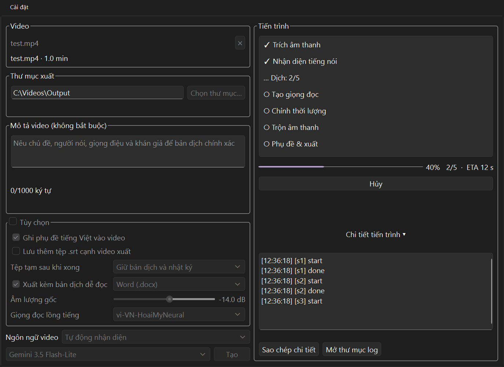
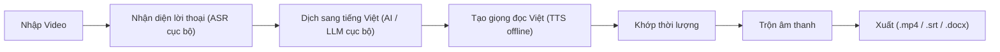

<p align="center">
  
</p>

<h1 align="center">DubTool</h1>

<p align="center">
  <strong>Ứng dụng desktop portable cho Windows giúp lồng tiếng video đa ngôn ngữ sang tiếng Việt — nhận diện giọng nói cục bộ, xoay tua tự động nhiều API Key AI, tạo giọng tiếng Việt offline và gắn phụ đề đồng bộ.</strong>
</p>

<p align="center">
  <a href="https://github.com/namtit2932k/dubtool/releases/latest"></a>
  <a href="https://github.com/namtit2932k/dubtool/actions/workflows/ci.yml"></a>
  <a href="../LICENSE"></a>
  
</p>

<p align="center">
  <a href="../README.md">English</a> · <strong>Tiếng Việt</strong>
</p>

<p align="center">
  <a href="https://github.com/namtit2932k/dubtool/releases/latest"></a>
</p>

---

## Tổng quan

**DubTool** chuyển video ngoại ngữ thành video lồng tiếng Việt kèm phụ đề đồng bộ. Ứng dụng kết hợp nhận diện tiếng nói cục bộ, dịch AI theo ngữ cảnh, tổng hợp giọng đọc tiếng Việt offline, tự động căn khớp thời lượng âm thanh và pipeline xử lý có thể tiếp tục bất cứ lúc nào — tất cả trong một ứng dụng Windows portable (Python + PySide6, đóng gói thành `.exe` độc lập kèm CLI đầy đủ).

- **Đầu vào:** Bất kỳ video ngoại ngữ nào (từ clip ngắn đến bài giảng, hướng dẫn hay phim dài nhiều giờ). Tệp video gốc **không bao giờ** bị sửa hay ghi đè.
- **Đầu ra:**
  - Video **`.mp4`** lồng tiếng Việt với âm thanh gốc được hạ nền hợp lý.
  - Phụ đề tiếng Việt **`.srt`** và/hoặc phụ đề gắn cứng vào video (tùy chọn bật/tắt).
  - Bản dịch song ngữ dễ đọc **`.docx` / `.txt`** xuất kèm cạnh video.
- **Bảo vệ video tiếng Việt:** Nếu video đầu vào đã là tiếng Việt, DubTool tự dừng trước bước dịch và đề xuất xuất phụ đề `.srt` cùng bản chép lời mà không gọi API dịch.

> ⚖️ Chỉ lồng tiếng video bạn sở hữu hoặc có quyền chỉnh sửa. Khi tải và sử dụng DubTool, bạn đồng ý với [Giấy phép MIT](../LICENSE) và các [thông báo bên thứ ba](../packaging/THIRD_PARTY.md).

---

## Ảnh chụp màn hình

| Cửa sổ chính (Sẵn sàng) | Chọn & tự động nhận diện ngôn ngữ |
| :---: | :---: |
|  |  |

| Tiến trình & độ tin cậy ngôn ngữ | Đang chạy & nút Hủy tức thì |
| :---: | :---: |
|  |  |

| Hoàn tất & mở nhanh đầu ra | Quản lý khóa API an toàn |
| :---: | :---: |
|  |  |

---

## Cách hoạt động



1. **Nhập Video** — Tự động nhận diện ngôn ngữ nói hoặc dùng ngôn ngữ bạn chọn thủ công.
2. **Nhận diện & Dịch** — Chuyển giọng nói thành văn bản ngay trên máy, sau đó dịch theo câu hoàn chỉnh kèm ngữ cảnh, mô tả ngắn (Brief) và từ điển thuật ngữ (Glossary).
3. **Tạo giọng, Khớp thời lượng & Xuất** — Tạo giọng tiếng Việt offline, căn khớp từng câu theo mốc thoại thực tế, hạ nền âm thanh gốc kèm limiter chống rè rồi xuất video, phụ đề và tệp bản dịch dễ đọc.

---

## Điểm nổi bật của DubTool

### Dịch thông minh & Xoay tua API Key miễn phí (Auto-Rotate)
- **Chế độ mặc định `auto-rotate`:** Tự động xoay vòng toàn bộ khóa API miễn phí **Gemini** và **Groq** bạn đã lưu trên nhiều luồng song song. Khi một khóa hoặc mô hình gặp quá tải tạm thời (`503`) hay chạm giới hạn (`429`), DubTool đưa slot đó vào cooldown và chuyển ngay sang khóa/nhà cung cấp sẵn sàng khác mà không phải chờ hết cooldown.
- **Tách biệt hoàn toàn gói miễn phí và trả phí:** Khóa **OpenAI** / **Anthropic** trả phí **không bao giờ** bị tự động sử dụng trong chế độ Auto-Rotate; khi bạn chủ động chọn mô hình trả phí, ứng dụng sẽ hỏi xác nhận trước lần chạy đầu.
- **Kiểm soát ngữ cảnh & chất lượng dịch:** Hỗ trợ **Mô tả ngắn (Brief)** định hướng thể loại/xưng hô, **Từ điển thuật ngữ (Glossary)**, đồng nhất đại từ xưng hô giữa các cụm dịch, và tự phát hiện/dịch lại nếu còn sót ký tự Hán/Kana/Hangul trong bản dịch tiếng Việt.

### Nhận diện giọng nói cục bộ & TTS tiếng Việt offline
- **ASR cục bộ (`faster-whisper`):** Chạy hoàn toàn trên máy tính với lọc khoảng lặng VAD, sửa trôi timestamp từ & tách khoảng lặng nội bộ, hỗ trợ bấm **Hủy** dừng ngay giữa chừng.
- **TTS tiếng Việt offline (`VieNeu-TTS v3 ONNX`):** Chạy trên CPU với chế độ tiêu chuẩn `v3turbo_int8` (48 kHz, 25 giọng, mặc định *Trúc Ly*) hoặc chế độ tiết kiệm RAM `v3nano` (24 kHz, 11 giọng), tích hợp sẵn nút **Nghe thử giọng**. Mô hình chỉ cần tải 1 lần đầu (~244–269 MB) và hoạt động offline cho các lần sau.

### Thiết kế cho video dài nhiều giờ
- **Checkpoint từng bước và từng cụm dịch:** Mọi stage (`s1`–`s7`) và từng cụm dịch đều được lưu checkpoint trên đĩa — bạn có thể hủy giữa chừng và bấm chạy tiếp mà không mất phần đã làm.
- **Tái sử dụng kết quả thông minh:** Khi đổi mô hình dịch, ứng dụng tự động giữ lại kết quả tách âm (`s1`) và nhận diện giọng nói (`s2`) đã có.
- **Trộn âm thanh streaming theo khối:** Dựng track lồng tiếng bằng `soundfile` + `numpy` theo từng khối 30 giây, giữ mức RAM ổn định, không tạo tệp WAV im lặng trung gian nhiều GB và tự động bật RF64 cho track dung lượng lớn (>3.8 GB).

### Đầu ra âm thanh & phụ đề chính xác
- **Căn khớp thời lượng từng câu:** Tự điều chỉnh tốc độ nhẹ (`atempo`) hoặc rút gọn câu dài bằng LLM rồi tạo lại giọng để mỗi câu khớp gọn khung thoại mà không đè lên câu kế tiếp.
- **Hòa âm cân bằng & phụ đề đồng bộ:** Hạ âm nền gốc (mặc định `−14 dB`) kèm bộ giới hạn `alimiter` chống méo tiếng, tạo `.srt` bám sát mốc phát thực tế, tùy chọn gắn phụ đề cứng qua `libass` + phông Noto Sans đóng gói sẵn, và xuất kèm tệp `.docx` / `.txt` dễ đọc.

### Quyền riêng tư & Quản lý khóa API an toàn
- **Phân tách rõ cục bộ và đám mây:** Nhận diện giọng nói, tạo giọng tiếng Việt (sau lần tải mô hình đầu tiên), trộn âm thanh và gắn phụ đề đều chạy cục bộ trên máy bạn. Khi dùng nhà cung cấp dịch đám mây, ứng dụng cần kết nối Internet và chỉ gửi văn bản lời thoại nguồn cùng ngữ cảnh tùy chọn bạn nhập (Brief / Glossary) tới nhà cung cấp đã chọn. Bạn có thể chọn **Ollama** nếu muốn dịch 100% cục bộ.
- **Lưu khóa mã hóa:** Trên ứng dụng desktop, khóa API được lưu trong **Windows Credential Manager** (hoặc `.env` cho CLI), hiển thị che ký tự trên giao diện, tự lọc khỏi log/chẩn đoán và không bao giờ ghi ra `settings.json` hay thư mục job.

---

## Kiến trúc Pipeline

DubTool vận hành theo **7 giai đoạn có thể tiếp tục** (`s1`–`s7`), theo sau là bước xuất tài liệu dễ đọc (`s8_export_readable.py`):

| Giai đoạn | Nhiệm vụ |
| --- | --- |
| **s1** Tách âm thanh | Trích xuất WAV mono 16 kHz từ video đầu vào bằng FFmpeg đóng gói sẵn |
| **s2** Nhận diện giọng nói | `faster-whisper` cục bộ tự phát hiện ngôn ngữ, VAD, sửa timestamp và hỗ trợ hủy giữa chừng |
| **s3** Dịch sang tiếng Việt | Dịch theo cụm câu kèm ngữ cảnh, Brief, Glossary, đồng nhất xưng hô và kiểm tra sót ký tự CJK |
| **s4** Tạo giọng đọc (TTS) | `VieNeu-TTS v3 ONNX` offline có cắt khoảng lặng thừa và cache WAV từng câu |
| **s5** Khớp thời lượng | Căn thời lượng từng đoạn vừa khung bằng `atempo` nhẹ hoặc rút gọn LLM + tạo lại giọng |
| **s6** Trộn & ghép âm | Trộn streaming khối 30 giây (`soundfile` + `numpy`, hỗ trợ RF64) đè nền gốc đã hạ âm + `alimiter` |
| **s7** Phụ đề & xuất video | Tạo `.srt` đồng bộ mốc phát thực tế và tùy chọn gắn phụ đề cứng (`libass` + Noto Sans) |
| *Sau pipeline* Xuất tài liệu | Xuất bản dịch song ngữ dễ đọc `.docx` / `.txt` cạnh video đầu ra |

Xem chi tiết ranh giới module, cơ chế resume và xử lý lỗi LLM tại [`docs/ARCHITECTURE.md`](ARCHITECTURE.md).

---

## Cài đặt & Sử dụng nhanh

### Cách 1: Bản Portable cho Windows (Khuyên dùng)

1. Tải tệp `DubTool-*-win64.zip` mới nhất tại [GitHub Releases](https://github.com/namtit2932k/dubtool/releases/latest) và giải nén vào thư mục bất kỳ.
2. Mở **`DubTool.exe`** (đã đóng gói sẵn FFmpeg và phông tiếng Việt Noto Sans, không cần cài Python).
3. Vào **Cài đặt → Khóa API** và thêm một hoặc nhiều khóa miễn phí:
   - [Google AI Studio](https://aistudio.google.com/apikey) (**Gemini** gói miễn phí), và/hoặc
   - [Groq Console](https://console.groq.com/keys) (**Groq** gói miễn phí — tự ghép cùng Gemini trong chế độ mặc định **Auto-Rotate**).
   - *(Tùy chọn)* Thêm khóa trả phí **OpenAI** / **Anthropic**, hoặc cấu hình **Ollama** cục bộ.
4. Kéo thả video vào cửa sổ, tùy chọn điền **Mô tả ngắn (Brief)** (vd: thể loại và cách xưng hô), chọn thư mục xuất và bấm **Tạo**.
   - *Chỉ lần chạy đầu:* Mô hình Whisper và VieNeu-TTS ONNX (~244–269 MB) tự động tải về `%LOCALAPPDATA%\DubTool\models\hf_cache`; các lần sau chạy ASR/TTS hoàn toàn offline.

### Cách 2: Chạy từ mã nguồn / dòng lệnh (CLI)

Yêu cầu **Python 3.11+** (khuyên dùng **3.13 x64**) và **FFmpeg trong `PATH`**.

```bash
pip install -e ".[gui,dev]"             # CLI + Giao diện Desktop (PySide6-Essentials, keyring) + pytest
pip install --no-deps "vieneu>=3.8,<4"  # VieNeu-TTS v3 ONNX (tránh kéo thư viện WebUI/gradio thừa)
copy .env.example .env                  # điền GEMINI_API_KEY=... và/hoặc GROQ_API_KEY=...
dubtool doctor                          # kiểm tra FFmpeg, khóa API và thư viện
```

**Mở giao diện Desktop:**

```bash
python -m dubtool.app.main
```

**Chạy qua dòng lệnh (CLI):**

```bash
dubtool run video.mp4 --source-language auto --model auto-rotate --tts-mode v3turbo_int8 --voice "Trúc Ly"
dubtool stage <job_id> <s1..s7> [--force]
dubtool status <job_id>
dubtool retts <job_id> --ids 3,7,12
```

- Truyền `--brief "nội dung"` hoặc đặt tệp `<ten_video>.brief.txt` cạnh video để định hướng văn phong/xưng hô.
- Sao chép `glossary.example.json` → `glossary.json` để cố định thuật ngữ (điền `"keep original"` để giữ nguyên từ gốc).
- Xem hướng dẫn đóng gói `DubTool.exe` từ mã nguồn tại [`README_BUILD.md`](../README_BUILD.md).

---

## Nhà cung cấp dịch

| Nhà cung cấp | Gói / Chế độ | Cấu hình | Vai trò |
| --- | --- | --- | --- |
| **Auto-Rotate** *(mặc định)* | Miễn phí | Khóa Gemini + Groq đã lưu | Xoay vòng toàn bộ khóa miễn phí Gemini & Groq khi quá tải/chạm giới hạn; không chạm khóa trả phí |
| **Gemini** | Miễn phí | `GEMINI_API_KEY` | Dịch JSON có cấu trúc trên các mô hình Gemini được hỗ trợ |
| **Groq Cloud** | Miễn phí | `GROQ_API_KEY` | Phản hồi nhanh với prompt gọn và xoay vòng nhiều khóa |
| **OpenAI** | Trả phí | `OPENAI_API_KEY` | Mô hình trả phí tùy chọn; hỏi xác nhận trước lần chạy đầu |
| **Anthropic** | Trả phí | `ANTHROPIC_API_KEY` | Mô hình Claude trả phí tùy chọn; hỏi xác nhận trước lần chạy đầu |
| **Ollama** | Cục bộ | `llm_provider: ollama` | Dịch hoàn toàn trên máy, không gửi dữ liệu ra ngoài |

Danh sách đầy đủ các mô hình được hỗ trợ nằm trong [`packaging/models.yaml`](../packaging/models.yaml), và cấu hình pipeline mặc định nằm trong [`config.yaml`](../config.yaml).

> **Mẹo cho video dài nhiều giờ:** Thêm nhiều khóa Gemini miễn phí (từ các Google Cloud project khác nhau) kết hợp khóa Groq miễn phí trong chế độ **Auto-Rotate** giúp giữ tiến độ ổn định khi một hãng tạm chạm giới hạn phút/ngày.

---

## Kiểm thử & Độ tin cậy kỹ thuật

DubTool được duy trì như một ứng dụng Windows hoàn chỉnh với hệ thống kiểm thử và kiểm chứng đóng gói tự động trên GitHub Actions (`.github/workflows/ci.yml`):

- **CI Windows đa phiên bản Python:** Kiểm thử trên **Python 3.11** (tương thích theo `pyproject.toml`) và **Python 3.13** (môi trường lockfile chuẩn qua [`packaging/requirements-lock.txt`](../packaging/requirements-lock.txt)).
- **600+ bài kiểm thử tự động offline:** Bộ test offline cùng các cổng kiểm tra runtime `--selftest`, hình học giao diện `--layout-check` và `--gui-smoke` cô lập — tất cả chạy không cần API key thật.
- **Kiểm chứng bản đóng gói release:** Job CI riêng build `DubTool.exe` từ `git archive` sạch bằng chính script phát hành ([`packaging/build_exe.ps1`](../packaging/build_exe.ps1)), xác minh SHA-256 tài nguyên đóng gói ([`packaging/vendor_manifest.json`](../packaging/vendor_manifest.json)), kiểm tra toàn vẹn/checksum tệp ZIP phát hành cùng `BUILD_INFO.txt`, rồi chạy kiểm thử khởi động, self-test, layout và GUI smoke trực tiếp từ tệp `.exe` giải nén ra từ ZIP.

Chạy kiểm thử cục bộ:

```bash
python -m pytest tests -m "not packaged" -q   # bộ test offline (không cần API key)
python -m dubtool.app.main --selftest         # kiểm tra FFmpeg, Qt, VieNeu và SDK nhà cung cấp
python -m dubtool.app.main --layout-check     # kiểm tra bố cục giao diện ở 25 kích thước × trạng thái
python -m dubtool.app.main --gui-smoke        # kiểm thử giao diện end-to-end trong môi trường cô lập
```

Tài liệu khác: [`docs/ARCHITECTURE.md`](ARCHITECTURE.md) · [`docs/RELEASES.md`](RELEASES.md) · [`README_BUILD.md`](../README_BUILD.md) · [`REPORT_UPDATE_19.md`](reports/REPORT_UPDATE_19.md)

---

## Quyền riêng tư & Giấy phép

- **Quyền riêng tư:** Nhận diện giọng nói (`faster-whisper`), tạo giọng tiếng Việt (`VieNeu-TTS v3 ONNX`, sau lần tải mô hình đầu tiên), trộn âm thanh và gắn phụ đề đều chạy cục bộ trên máy bạn. Khi sử dụng nhà cung cấp dịch đám mây, chỉ văn bản lời thoại nguồn cùng ngữ cảnh tùy chọn bạn cung cấp (Brief và Glossary) được gửi tới nhà cung cấp bạn chọn. Để dịch hoàn toàn cục bộ, hãy chọn **Ollama**. Khóa API lưu trong Windows Credential Manager (hoặc `.env`) và không bao giờ ghi ra log.
- **Giấy phép:** [Giấy phép MIT](../LICENSE) — Copyright (c) 2026 sickyturtlez. Các thành phần bên thứ ba đi kèm (FFmpeg GPL v3, PySide6 LGPL v3, faster-whisper, VieNeu-TTS, sea-g2p, soundfile, Noto Sans) giữ nguyên giấy phép riêng (chi tiết tại [`packaging/THIRD_PARTY.md`](../packaging/THIRD_PARTY.md)).
